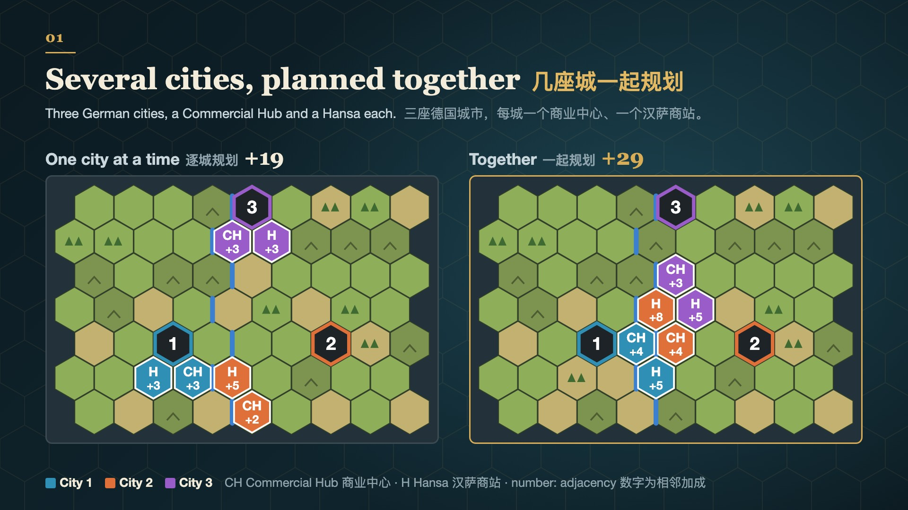
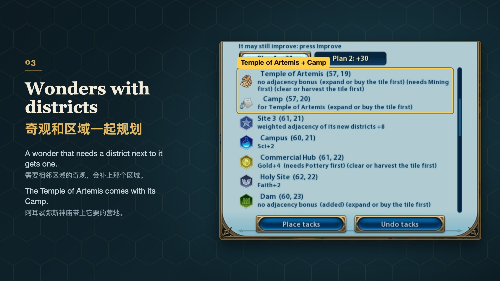
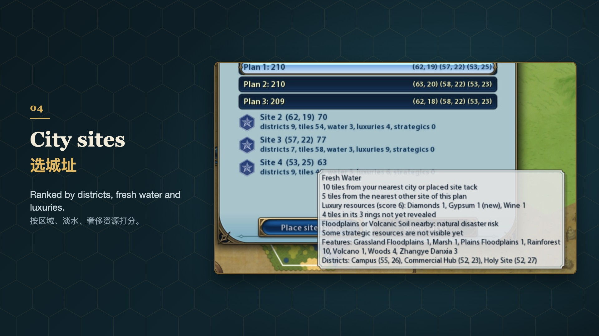
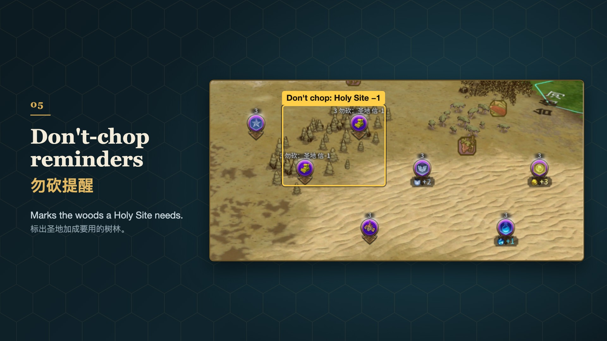
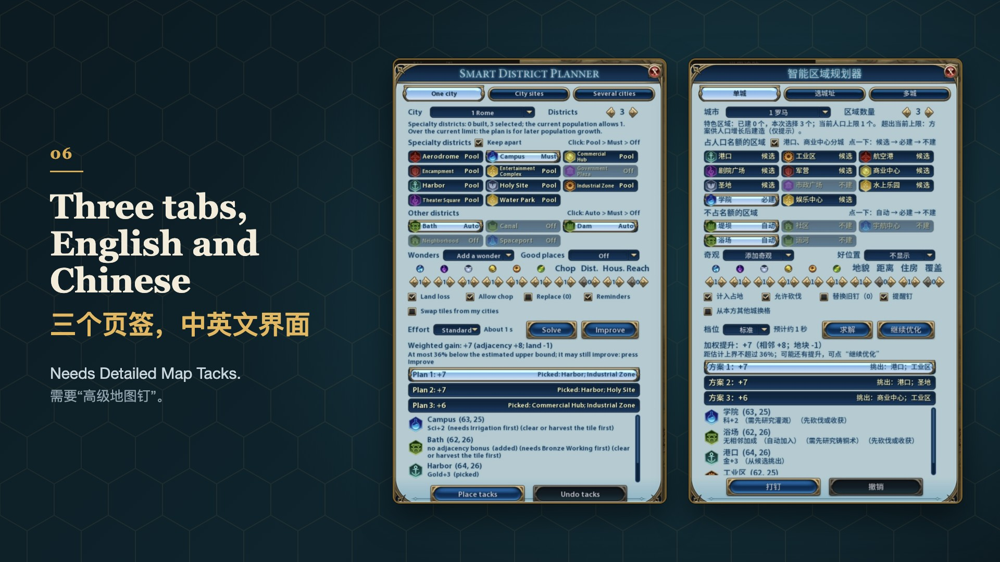

# Smart District Planner 智能区域规划器

**[English](#english)** · **[中文](#中文)**

<p>
 
 
 
</p>

## English

A district planner for Civilization VI: pick a city and the districts you want, and in a few seconds it finds the layout with the highest adjacency bonus within the city's 3 rings and places it as map tacks with district icons. It also chooses sites for new cities and plans several cities together. Where a district fits and what it gets come from [Detailed Map Tacks](https://steamcommunity.com/sharedfiles/filedetails/?id=2428969051) (DMT), so the numbers in a plan are the numbers on the tacks.

**[Steam Workshop](https://steamcommunity.com/sharedfiles/filedetails/?id=3824473635)** · **[Download](https://github.com/SmallSpider0/civ6-smart-district-planner/releases/latest)** · **[Overview](https://smallspider0.github.io/civ6-smart-district-planner/en/)** · **[Install and use](docs/install-en.md)**

### Why use it

- **Your civilization's rules, with no setup.** Adjacency and placement rules from your civilization, your leader, your pantheon and your religion's beliefs are counted, and your unique districts are used: Japan's districts get +1 from each other, Korea's Seowon loses yield next to districts, Gaul's specialty districts stay off the City Center, Vietnam's go on Woods, Rainforest or Marsh.
- **Close to the best possible, and it tells you how close.** With few districts it tries every layout, so the plan is the best one; otherwise it says at most how far from the best it may be, and you can press **Improve**. Checked against real games: from games that 8 strong players shared with their saves on CivFanatics, 17 city layouts (turns 58–276; [each scene with maps](docs/reference-scenes.md), in Chinese) were planned again on the saved maps, counting adjacency only. The players' layouts reach on average 90.4% of the proven optimum; the Standard effort reaches 99.8% and hits it exactly in 16 of 17. The players built their cities step by step, though, without knowing what would come later.
- **Several cities at once.** Up to 8 cities, including site tacks for cities not founded yet. Districts share adjacency across cities, and districts limited to one per empire, like the Government Plaza, go to the city where they do the most. In the test scenarios, planning the cities one at a time reaches only about 95% of the best known plan.
- **Borrows tiles from your other cities.** Tiles you can swap from your own cities are used (on by default, can be turned off). On real saves this gives about 13% more adjacency for one city and 19% for several; some districts then need a Swap in Manage Citizens, and the result marks them.
- **Never a tile you cannot build on, never moves what you have.** Luxury and strategic resources stay uncovered, empire limits and city borders are checked, and on tiles a city owns the game's own list of valid tiles is checked too. Built districts and your own tacks stay where they are and count as neighbors.
- **Wonders with their rules.** Add wonders and they are planned with the districts: the Colosseum gets an Entertainment Complex next to it when the city has none, and the Temple of Artemis comes with its Camp.

The panel has three tabs:

- **One city**: set the districts you must have to Must, leave the rest in the Pool, and say how many districts the city should end up with. **Solve** gives three plans with different districts; click one to preview it on the map, then **Place tacks**. **Undo tacks** works too, also after loading a save.
- **City sites**: chooses spots for new cities on the explored map. Each site is scored on district potential, tiles, resources and Housing; hover a score for the yields behind it. **Dense packing** fits in as many cities as possible; tick the sites you want.
- **Several cities**: plans the city selected on the map with the nearest cities and site tacks (4 by default, up to 8). Each city can have its own district list; **Apply a template** fills one for Science, Production or another yield from your civilization's rules.

Also:

- Lean toward a yield with the Science, Culture or Religion preset, or set each weight yourself.
- Districts stay off tiles that would make good farms or mines unless the bonus is worth it.
- Neighborhoods go where Appeal gives the most Housing. An Aqueduct is added when a city lacks fresh water, a Dam when it has enough Floodplains.
- When a plan relies on nearby Woods or Rainforest, a "Don't chop" tack on those tiles says what chopping would cost.
- **Good places**: pick a district and the map colors every tile it can go on by its bonus.
- To plan again, turn on "Replace this mod's earlier tacks": the old tacks are replaced, and Undo tacks puts them back.
- Long searches run over several frames, so you can keep playing or close the panel. <kbd>Shift</kbd>+<kbd>L</kbd> opens the panel. Settings are kept in the save.
- Base game, Rise and Fall, and Gathering Storm; the panel is in English and Chinese and follows the game's language.

How close its plans come to the true optimum, its speed and known limitations: see the [overview](https://smallspider0.github.io/civ6-smart-district-planner/en/).

> ⚠️ **One planner per game**: do not enable it together with Auto Map Tacks Planner, Empire Planner or another district planner; they disturb each other.

### Install

1. Subscribe to [Smart District Planner](https://steamcommunity.com/sharedfiles/filedetails/?id=3824473635) and [Detailed Map Tacks](https://steamcommunity.com/sharedfiles/filedetails/?id=2428969051) on the Steam Workshop.
2. In the main menu's Additional Content, enable Detailed Map Tacks and Smart District Planner, then restart the game.

Without the Workshop, download the zip from the [releases page](https://github.com/SmallSpider0/civ6-smart-district-planner/releases/latest) and put the `SmartDistrictPlanner` folder in it into the game's Mods folder (DMT is still needed):
- Windows: `Documents\My Games\Sid Meier's Civilization VI\Mods\`
- macOS: `~/Library/Application Support/Sid Meier's Civilization VI/Sid Meier's Civilization VI/Mods/`

Keep only one copy: with one in Mods and one from the Workshop, the game loads only one of them, not necessarily the newer one or the one you enabled. When you switch to the Workshop, delete that folder from Mods.

How to use each tab, known limitations and troubleshooting: [install and use](docs/install-en.md). Report problems on [Issues](https://github.com/SmallSpider0/civ6-smart-district-planner/issues), in English or Chinese. Each [release](https://github.com/SmallSpider0/civ6-smart-district-planner/releases) lists its changes in English and Chinese; the [CHANGELOG](CHANGELOG.md) is in Chinese.

### Similar mods

| | [Auto Map Tacks Planner](https://steamcommunity.com/sharedfiles/filedetails/?id=3771382002) | [Empire Planner](https://steamcommunity.com/sharedfiles/filedetails/?id=3793348626) | [District & Wonder Planner](https://steamcommunity.com/sharedfiles/filedetails/?id=3780936549) | This mod |
|---|---|---|---|---|
| Districts | ✓ | ✓ | ✓ up to 3 kinds at a time (plus Aqueduct and Government Plaza) | ✓ |
| Wonders | ✓ | ✓ | ✓ up to 5 | ✓ |
| Improvements | ✓ unique improvements included | ✓ | ◐ only the one a wonder needs | ◐ only the one a wonder needs (the Camp for the Temple of Artemis) |
| New city sites | — future cities from your City Center tacks | ✓ 0–6 | — future cities from your City Center tacks | ✓ 1–6, up to 12 with dense packing |
| Cities planned together | ✓ up to 4 | ✓ every existing city and the new sites, in one go | ✓ all cities, with a tick | ✓ up to 8 (site tacks included) |
| Places map tacks | ✓ | ✓ | ✓ | ✓ |
| Needs DMT | ✓ | — the author advises turning DMT off | ✓ | ✓ |
| Bonuses computed by | DMT | its own rules | DMT | DMT |
| Rulesets | not stated | Rise and Fall, Gathering Storm (the author says the base game is untested) | not stated | Base game, Rise and Fall, Gathering Storm |
| Interface languages | English, Simplified Chinese, Traditional Chinese | English | English, Simplified Chinese | English, Simplified Chinese |
| Not to be enabled with (as the author states) | not stated | DMT | not stated | other district planners |
| Updated on the Workshop | 2026-09-19 (r49) | 2026-09-10 | 2026-08-29 (v1.1) | 2026-10-25 |

✓ yes · ◐ partly · — no

Checked on 2026-10-26 against each mod's Workshop page and files; "not stated" means neither says. The Workshop titles are Fully Automatic Map Tacks Planner【Four-City Linked】, Empire Planner + (Auto Map Tacks) Advanced and District & Wonder Planner v1.1; they are updated over time, so their own pages are the reference.

Features not in the table:

- **Auto Map Tacks Planner**: takes your "Remove Feature / Harvest Resource / Plant Woods" tacks as instructions; two modes, "only what is unlocked" and "long-term blueprint".
- **Empire Planner**: limits the plan to an era; keeps 3 layouts in the save.
- **District & Wonder Planner**: weights districts by their order.
- **This mod**: tells you when a plan is the best possible, or at most how far from it it may be.

Detailed Map Tacks is not a planner: it shows on a map tack the yields and adjacency a district or wonder would get there.

### Development

The development documents are in Chinese; issues and pull requests in English are welcome. Start with [CONTRIBUTING.md](CONTRIBUTING.md), in English and Chinese: the hard constraints, setup, the checks you can run with and without the game, code conventions and how to submit a pull request. [AGENTS.md](AGENTS.md) has the requirements, design constraints, modding pitfalls and workflow.

| Document | Contents |
|------|------|
| [docs/dev-macos.md](docs/dev-macos.md), [docs/dev-windows.md](docs/dev-windows.md) | The development setup on each platform |
| [tools/README.md](tools/README.md) | Tools: validation, deployment, in-game tests, the offline comparison |
| [docs/workflow.html](docs/workflow.html) | Development workflow overview (in Chinese), also published with each release: [web page](https://smallspider0.github.io/civ6-smart-district-planner/workflow/) |
| [docs/workshop-upload.md](docs/workshop-upload.md) | Uploading the package to the Steam Workshop (Windows) |
| [docs/design.md](docs/design.md) | The solver, the objective, the seam with DMT, the modules |
| [docs/multicity-design.md](docs/multicity-design.md) | City sites, several cities, wonders, effort levels, offline benchmarks, and the changes made after each round of hands-on testing |
| [docs/self-test-report.md](docs/self-test-report.md) | Self-test report: evidence for each acceptance item, test results, screenshots |
| [civ6-mod-from-scratch-prompt.md](civ6-mod-from-scratch-prompt.md) | The requirements |

### Acknowledgements

- [Detailed Map Tacks](https://steamcommunity.com/sharedfiles/filedetails/?id=2428969051) (D, wltk): every placement check and adjacency bonus in this mod is computed by it, and it shows the numbers on the map tacks.
- [Auto Map Tacks Planner](https://steamcommunity.com/sharedfiles/filedetails/?id=3771382002): these ideas come from it: the wonder dropdown sorted by era, then by cost; the "Good places" coloring; per-city lists and templates by yield on the Several cities tab; an empire-limited district going only to the cities whose list has it; coverage; undo records kept with the save; replacing this mod's earlier tacks; the Shift+L hotkey.
- [Empire Planner](https://steamcommunity.com/sharedfiles/filedetails/?id=3793348626): checking plans on the tiles a city owns against the tiles the game engine allows comes from it.

### License

[MIT](LICENSE). This repository contains no code or data of Detailed Map Tacks, other mods or the game; players subscribe to DMT themselves.

---

## 中文

《文明6》区域规划模组：选一座城和想建的区域，几秒钟在城市三环内算出相邻加成最高的摆法，一键打成带区域图标的地图钉；也能给新城选址，让几座城一起规划。能不能放、加成多少都由 [Detailed Map Tacks](https://steamcommunity.com/sharedfiles/filedetails/?id=2428969051)（DMT）算，规划里的数就是打钉后钉上显示的数。

**[创意工坊](https://steamcommunity.com/sharedfiles/filedetails/?id=3824473635)** · **[下载](https://github.com/SmallSpider0/civ6-smart-district-planner/releases/latest)** · **[介绍页](https://smallspider0.github.io/civ6-smart-district-planner/)** · **[安装与使用](docs/install-and-test.md)**

### 为什么用它

- **按你的文明来算，不用设置**。文明能力、领袖能力、万神殿和宗教信条里的相邻加成和放置限制都自动算进去，特色区域也自动换上：日本的区域互相挨着各 +1，朝鲜的书院挨着别的区域会减产，高卢的特色区域不能挨市中心，越南的特色区域只能建在森林、雨林、沼泽上。
- **接近最优，还告诉你差多少**。区域少时把所有摆法都试一遍，结果就是最优；区域多时写明“最多还差百分之几”，可以点“继续优化”。拿实战对照：从 CivFanatics 上 8 位高手附存档分享的对局里取出 17 个城市布局（回合 58–276，[逐个场景的图](docs/reference-scenes.md)），按存档里的地图重新规划、只算相邻加成，高手的布局平均是证明过的真最优的 90.4%，本模组标准档平均 99.8%，17 个里 16 个正好最优。不过高手的城是一步步建起来的，早放的区域不知道后来的情况。
- **几座城一起摆**。最多 8 座城（含还没建的城址钉）一起规划，区域可以跨城互相给加成，市政广场这类全帝国只有一个的区域会放到最合适的那座城。测试场景里，一座一座分开规划平均只拿到已知最好方案的约 95%。
- **借邻城的格**。本方其他城能换过来的格也会用上（默认打开，可关）。真实存档上，相邻加成单城平均多约 13%、多城多约 19%；代价是部分区域要在“市民管理”里点“切换”把格换过来，结果里会标出来。
- **不给你建不了的位置，不动你已有的**。不压奢侈和战略资源，查帝国上限和城市范围，城市已有的格再用游戏自己的可建格核对一遍。已建的区域和你自己打的钉一律不动，还会当作邻居算加成。
- **奇观一起放**。选上想建的奇观，它连同区域一起规划：罗马斗兽场要挨着娱乐中心，城里没有就补一个；阿耳忒弥斯神庙会带上它要的营地。

面板有三个页签：

- **单城**：把想要的区域点成“必建”，其余留作“候选”，说这座城一共要几个区域。点“求解”得到三套组合不同的方案，点一套在地图上预览，满意就“打钉”；可以“撤销”，读档后也能撤销。
- **选城址**：在已探索的地图上给新城选位置。每个城址按区域潜力、地块、资源、住房打分，悬停看每项背后是多少产出；打开“密铺”可以尽量多放新城，再勾选要哪几座。
- **多城**：以地图上选中的城为中心，和离它最近的城市、城址钉（默认 4 座，最多 8 座）一起规划。每座城可以有自己的区域清单；“套用模板”按你文明的规则，为科技、生产力等产出一键生成区域清单。

还能做什么：

- 偏向某种产出：选“科技”“文化”“宗教”预设，或自己调各项权重。
- 不乱占好地：区域尽量不压能修出好改良的格。
- 社区放在魅力高的地方，多给住房；缺淡水时自动加水渠，泛滥平原多时自动加堤坝。
- 方案靠旁边的森林、雨林拿加成时，在那些格上打“勿砍”提醒钉，写明砍掉会少多少。
- “好位置”：选一个区域，地图上给它能放的格按加成高低上色。
- 想重新规划：打开“替换本模组之前打的钉”，旧钉换成新的，撤销时放回。
- 算得久时分几帧算，游戏照常操作，关掉面板也会算完。<kbd>Shift</kbd>+<kbd>L</kbd> 打开面板。设置随存档保存。
- 原版、迭起兴衰、风云变幻都能用；界面中英双语，跟随游戏语言。

方案离真最优多远、速度和已知限制，见[介绍页](https://smallspider0.github.io/civ6-smart-district-planner/)。

> ⚠️ **一局只开一个规划器**：不要和 Auto Map Tacks Planner、Empire Planner 等区域规划模组同时启用，它们会互相干扰。

### 安装

1. 在创意工坊订阅[智能区域规划器](https://steamcommunity.com/sharedfiles/filedetails/?id=3824473635)和 [Detailed Map Tacks](https://steamcommunity.com/sharedfiles/filedetails/?id=2428969051)。
2. 主菜单“额外内容”里勾上 Detailed Map Tacks 和“智能区域规划器”，重启游戏。

不用创意工坊的话，从[发布页](https://github.com/SmallSpider0/civ6-smart-district-planner/releases/latest)下载压缩包，把里面的 `SmartDistrictPlanner` 文件夹放进游戏的 Mods 文件夹（DMT 仍要订阅）：
- Windows：`文档\My Games\Sid Meier's Civilization VI\Mods\`
- macOS：`~/Library/Application Support/Sid Meier's Civilization VI/Sid Meier's Civilization VI/Mods/`

只留一份：Mods 里和创意工坊各有一份时，游戏只加载其中一份，不一定是新的，也不一定是你启用的那份。改用创意工坊版时，把 Mods 里的这个文件夹删掉。

各页签的用法、已知限制和排错见[安装与使用](docs/install-and-test.md)。问题请在 [Issues](https://github.com/SmallSpider0/civ6-smart-district-planner/issues) 反馈，更新内容见 [CHANGELOG](CHANGELOG.md)。

### 同类模组

| | [Auto Map Tacks Planner](https://steamcommunity.com/sharedfiles/filedetails/?id=3771382002) | [Empire Planner](https://steamcommunity.com/sharedfiles/filedetails/?id=3793348626) | [District & Wonder Planner](https://steamcommunity.com/sharedfiles/filedetails/?id=3780936549) | 本模组 |
|---|---|---|---|---|
| 区域 | ✓ | ✓ | ✓ 一次最多 3 种（另加水渠、市政广场） | ✓ |
| 奇观 | ✓ | ✓ | ✓ 最多 5 座 | ✓ |
| 改良设施 | ✓ 含特色改良设施 | ✓ | ◐ 只规划奇观需要的那一种 | ◐ 只规划奇观需要的那一种（阿耳忒弥斯神庙旁的营地） |
| 选新城址 | — 未来的城用你打的城市中心钉 | ✓ 0–6 处 | — 未来的城用你打的城市中心钉 | ✓ 1–6 处，密铺最多 12 处 |
| 几座城一起规划 | ✓ 最多 4 座 | ✓ 全部现有城市和新城址一次规划 | ✓ 可勾选全部城市 | ✓ 最多 8 座（含城址钉） |
| 打地图钉 | ✓ | ✓ | ✓ | ✓ |
| 需要 DMT | ✓ | — 作者建议关掉 DMT | ✓ | ✓ |
| 加成由谁计算 | DMT | 自己的规则 | DMT | DMT |
| 规则集 | 未写明 | 迭起兴衰、风云变幻（作者说原版没测过） | 未写明 | 原版、迭起兴衰、风云变幻 |
| 界面语言 | 英文、简体中文、繁体中文 | 英文 | 英文、简体中文 | 英文、简体中文 |
| 作者写明的同开限制 | 未写 | DMT | 未写 | 其他区域规划器 |
| 创意工坊页面的更新日期 | 2026-09-19（r49） | 2026-09-10 | 2026-08-29（v1.1） | 2026-10-25 |

✓ 是 · ◐ 部分 · — 否

2026-10-26 按各模组的创意工坊页面和模组文件核对；页面和文件都没写的标“未写明”。创意工坊上的标题分别是 Fully Automatic Map Tacks Planner【Four-City Linked】、Empire Planner + (Auto Map Tacks) Advanced、District & Wonder Planner v1.1；它们会更新，以各自页面为准。

表里没列的功能：

- **Auto Map Tacks Planner**：把你打的“移除地貌 / 采收 / 种树”钉当作规划指令；“只用已解锁的内容”和“长期蓝图”两种模式。
- **Empire Planner**：按时代限定规划范围；存档里保存 3 套布局。
- **District & Wonder Planner**：按区域的先后顺序给权重。
- **本模组**：结果写明这已经是最好的摆法，或者最多还差百分之几。

Detailed Map Tacks 不是规划器：它在地图钉上显示区域、奇观放在这一格时的产出和相邻加成。

### 参与开发

先读 [CONTRIBUTING.md](CONTRIBUTING.md)（中英文：硬约束、环境、开不开游戏都能跑的检查、代码约定、怎么提交 PR）和 [AGENTS.md](AGENTS.md)（需求约束、技术方案、模组开发的坑、工作流程）。维护者的流程、分工和发版写在 [docs/maintaining.md](docs/maintaining.md)。

| 文档 | 内容 |
|------|------|
| [docs/dev-macos.md](docs/dev-macos.md)、[docs/dev-windows.md](docs/dev-windows.md) | 两个平台的开发环境 |
| [tools/README.md](tools/README.md) | 校验、部署、游戏内测试、离线对比等工具 |
| [docs/workflow.html](docs/workflow.html) | 开发流程一览，发版时也发布到[网页](https://smallspider0.github.io/civ6-smart-district-planner/workflow/) |
| [docs/workshop-upload.md](docs/workshop-upload.md) | 把提交包上传到 Steam 创意工坊（Windows） |
| [docs/design.md](docs/design.md) | 求解算法、目标函数、与 DMT 的接缝、模块结构 |
| [docs/multicity-design.md](docs/multicity-design.md) | 选城址、多城、奇观、求解档位、离线基准，以及历次实测反馈的改进 |
| [docs/self-test-report.md](docs/self-test-report.md) | 自测报告：验收清单逐项证据、测试结果、截图 |
| [civ6-mod-from-scratch-prompt.md](civ6-mod-from-scratch-prompt.md) | 需求文档 |

```
SmartDistrictPlanner/        模组本体：复制到游戏 Mods 目录即可运行
  SmartDistrictPlanner.modinfo
  Text/                      中英文本
  UI/SDP_Panel.xml/.lua      启动栏按钮与规划面板
  Scripts/                   规则、城市扫描、假想钉层、增量评估（SDP_Board）、搜索引擎（SDP_Search）、
                             单城/多城/城址求解器、档位、分帧任务、预览、打钉、提醒钉
tests/                       游戏内测试（经 FireTuner 执行）；tests/offline 为离线测试与基准，tests/compare 为离线评估
tools/                       校验、部署、测试运行器、游戏控制、打包、路径（paths.py）
report/                      介绍页的生成脚本与模板（发布时由 GitHub Actions 生成并发布）
docs/                        设计、安装说明、自测报告、开发环境、截图
```

### 致谢

- [Detailed Map Tacks](https://steamcommunity.com/sharedfiles/filedetails/?id=2428969051)（D、wltk）：本模组的合法性判断和相邻加成全部由它计算，地图钉上的数也由它显示。
- [Auto Map Tacks Planner](https://steamcommunity.com/sharedfiles/filedetails/?id=3771382002)：这些做法学自它：奇观下拉框按时代、再按造价排列；“好位置”着色；多城页签的逐城清单和按产出生成的模板；全帝国限量的区域只放进写了它的城；覆盖范围；撤销记录随存档保存；替换本模组之前打的钉；Shift+L 快捷键。
- [Empire Planner](https://steamcommunity.com/sharedfiles/filedetails/?id=3793348626)：在城市已拥有的格上，用游戏引擎给出的可建格复核方案，学自它。

### 许可证

[MIT](LICENSE)。本仓库不含 Detailed Map Tacks 及其他模组、游戏本体的代码或数据；玩家需自行订阅 DMT。
