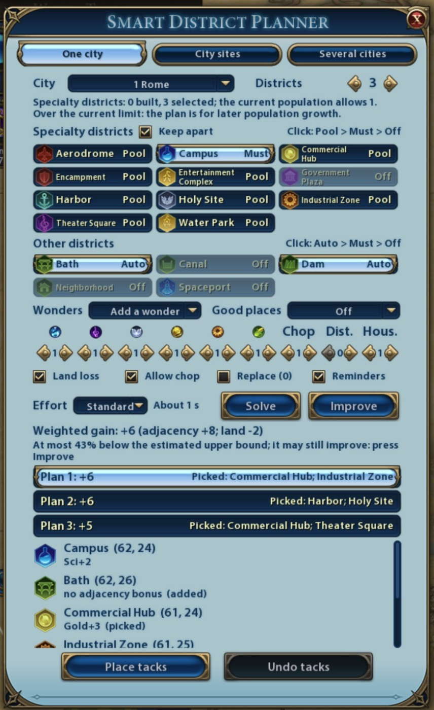
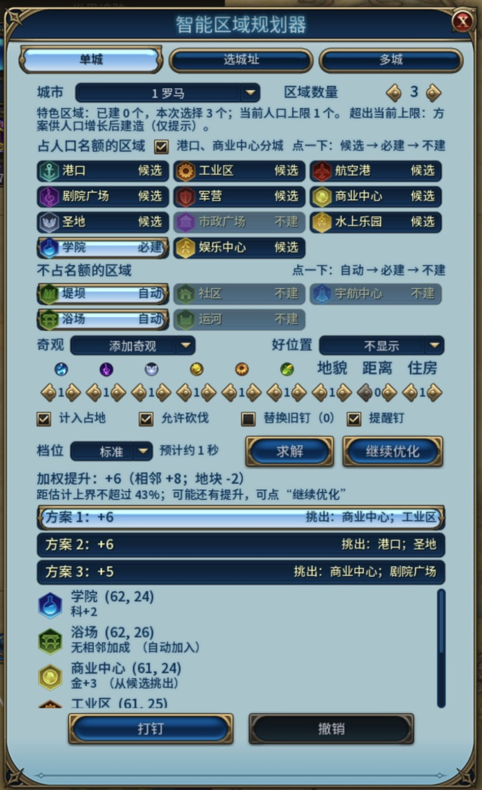

# Smart District Planner 智能区域规划器

**[English](#english)** · **[中文](#中文)**

## English

A district planner for Civilization VI: pick a city and the districts you want, and it searches the city's 3 rings for the layout with the highest adjacency bonus and places it as map tacks with district icons in one click. It also chooses sites for new cities and plans several cities together. Placement rules and bonuses all come from [Detailed Map Tacks](https://steamcommunity.com/sharedfiles/filedetails/?id=2428969051) (DMT), so they match the numbers on the tacks.

**[Steam Workshop](https://steamcommunity.com/sharedfiles/filedetails/?id=3824473635)** · **[Download](https://github.com/SmallSpider0/civ6-smart-district-planner/releases/latest)** · **[Overview and evaluation](https://smallspider0.github.io/civ6-smart-district-planner/en/)** · **[Install and use](docs/install-en.md)**



### What it does

The panel has three tabs:

- **One city**: pick a city, mark each district Must, Pool or Off, and set how many districts to plan and how much each yield counts. The planner finds the layout with the highest weighted adjacency within the city's 3 rings; when it picks from the pool you get three plans with different districts. Click one to preview it on the map, then place the tacks. Wonders can be planned along with the districts.
- **City sites**: choose sites for new cities on the explored map, weighing fresh water, workable tiles, Luxury and Strategic resources, district potential, and how much the new cities overlap. Three plans; hover a site for the resources it gets and how far it is from the other sites; preview on the map, then place site tacks.
- **Several cities**: plan districts and wonders for the site tacks and the cities near them together, counting adjacency across cities and empire limits. Each city can have its own district list, or a template built from your civilization's adjacency rules (Science city, Production city…).

On every tab:

- Three effort levels: Fast, Standard and Thorough. Small cases are solved exhaustively; otherwise the result says whether it is the best or how far it may be from an upper bound, and you can keep improving it. The same game state and settings give the same plan every time.
- Built districts and the tacks you placed yourself are never moved or covered and count as neighbors; districts limited to one per empire (such as the Government Plaza) are never planned twice.
- Each result row gives the tile and the bonus; hover it for DMT's breakdown.
- Neighborhoods get Housing from Appeal; Preserves count Appeal and the yields they give nearby tiles. An Aqueduct is added when the city lacks fresh water, a Dam when there are enough Floodplains tiles. When a plan takes adjacency from nearby Woods or Rainforest, placing it also puts a "Don't chop" reminder tack on those tiles.
- Long computations run over several frames, so the game stays responsive, and they finish even if you close the panel. Placed tacks can be undone, also after loading a save. <kbd>Shift</kbd>+<kbd>L</kbd> opens the panel.
- Base game, Rise and Fall, and Gathering Storm; the panel is in English and Chinese and follows the game's language.

How it compares with Auto Map Tacks Planner and Empire Planner on the same positions, its speed and known limitations: see the [overview and evaluation](https://smallspider0.github.io/civ6-smart-district-planner/en/).

> ⚠️ **One planner per game**: do not enable it together with Auto Map Tacks Planner, Empire Planner or another district planner; they disturb each other.

### Install

1. Subscribe to [Smart District Planner](https://steamcommunity.com/sharedfiles/filedetails/?id=3824473635) and [Detailed Map Tacks](https://steamcommunity.com/sharedfiles/filedetails/?id=2428969051) on the Steam Workshop.
2. In the main menu's Additional Content, enable Detailed Map Tacks and Smart District Planner, then restart the game.

Without the Workshop, download the zip from the [releases page](https://github.com/SmallSpider0/civ6-smart-district-planner/releases/latest) and put the `SmartDistrictPlanner` folder in it into the game's Mods folder (DMT is still needed):
- Windows: `Documents\My Games\Sid Meier's Civilization VI\Mods\`
- macOS: `~/Library/Application Support/Sid Meier's Civilization VI/Sid Meier's Civilization VI/Mods/`

Keep only one copy: with one in Mods and one from the Workshop, the game loads only one of them, not necessarily the newer one or the one you enabled. When you switch to the Workshop, delete that folder from Mods.

How to use each tab, known limitations and troubleshooting: [install and use](docs/install-en.md). Report problems on [Issues](https://github.com/SmallSpider0/civ6-smart-district-planner/issues), in English or Chinese. Each [release](https://github.com/SmallSpider0/civ6-smart-district-planner/releases) lists its changes in English and Chinese; the [CHANGELOG](CHANGELOG.md) is in Chinese.

### Development

The development documents are in Chinese; issues and pull requests in English are welcome. Start with [CONTRIBUTING.md](CONTRIBUTING.md) (branches, commits, who runs which tests, writing rules) and [AGENTS.md](AGENTS.md) (requirements, design constraints, modding pitfalls, workflow).

| Document | Contents |
|------|------|
| [docs/dev-macos.md](docs/dev-macos.md), [docs/dev-windows.md](docs/dev-windows.md) | The development setup on each platform |
| [tools/README.md](tools/README.md) | Tools: validation, deployment, in-game tests, the offline comparison |
| [docs/workshop-upload.md](docs/workshop-upload.md) | Uploading the package to the Steam Workshop (Windows) |
| [docs/design.md](docs/design.md) | The solver, the objective, the seam with DMT, the modules |
| [docs/multicity-design.md](docs/multicity-design.md) | City sites, several cities, wonders, effort levels, offline benchmarks, and the changes made after each round of hands-on testing |
| [docs/self-test-report.md](docs/self-test-report.md) | Self-test report: evidence for each acceptance item, test results, screenshots |
| [civ6-mod-from-scratch-prompt.md](civ6-mod-from-scratch-prompt.md) | The requirements |

### License

[MIT](LICENSE). This repository contains no code or data of Detailed Map Tacks, other mods or the game; players subscribe to DMT themselves.

---

## 中文

《文明6》区域规划模组：选一座城和想建的区域，它在城市三环内找相邻加成最高的摆法，一键打成带区域图标的地图钉；也能给新城选址，让几座城一起规划。合法性和加成全部由 [Detailed Map Tacks](https://steamcommunity.com/sharedfiles/filedetails/?id=2428969051)（DMT）计算，与地图钉上显示的数一致。

**[创意工坊](https://steamcommunity.com/sharedfiles/filedetails/?id=3824473635)** · **[下载](https://github.com/SmallSpider0/civ6-smart-district-planner/releases/latest)** · **[介绍与评测](https://smallspider0.github.io/civ6-smart-district-planner/)** · **[安装与使用](docs/install-and-test.md)**



### 能做什么

面板有三个页签：

- **单城**：选一座城，把区域设为必建、候选或不建，给出区域数量和各产出的权重。规划器在城市三环内找加权相邻加成最高的摆法；从候选里挑时给出组合不同的三套方案，点一套就在地图上预览，再一键打钉。单城也能一起放奇观。
- **选城址**：在已探索的地图上给几座新城选位置，考虑水源、耕作地块、奢侈与战略资源、区域潜力，以及新城之间不抢地。给出三套方案，悬停看每个城址拿到的奢侈、战略资源和离其他城址多远，预览后打城址钉。
- **多城**：城址钉和附近的现有城市一起规划区域和奇观，跨城的相邻加成和帝国上限都计入。可以给每座城单独的区域清单，或套用按产出生成的模板（科技城、生产力城……）。

各页签共用：

- 快速、标准、精细三档；规模小时穷举，结果注明是否最优或离上界多远，可以继续优化。同一局面、同样输入，结果每次相同。
- 已建区域和你自己打的钉不挪、不压，并作为邻居计分；全帝国限量的区域（如市政广场）不会重复规划。
- 结果行显示坐标和加成，悬停看 DMT 的逐项来源。
- 社区按魅力计住房，保护区计魅力和周边产出；缺淡水时自动加水渠，泛滥平原多时自动加堤坝；方案靠旁边的树林、雨林拿加成时，打钉时在这些格上加“勿砍”提醒钉。
- 耗时长的计算分帧进行，游戏不卡，关掉面板也会算完。可以撤销，撤销记录随存档保存。<kbd>Shift</kbd>+<kbd>L</kbd> 打开面板。
- 原版、迭起兴衰、风云变幻都能用；界面中英双语，跟随游戏语言。

和 Auto Map Tacks Planner、Empire Planner 在同样局面下的对比结果、速度和已知限制，见[介绍与评测](https://smallspider0.github.io/civ6-smart-district-planner/)。

> ⚠️ **一局只开一个规划器**：不要和 Auto Map Tacks Planner、Empire Planner 等区域规划模组同时启用，它们会互相干扰。

### 安装

1. 在创意工坊订阅[智能区域规划器](https://steamcommunity.com/sharedfiles/filedetails/?id=3824473635)和 [Detailed Map Tacks](https://steamcommunity.com/sharedfiles/filedetails/?id=2428969051)。
2. 主菜单“额外内容”里勾上 Detailed Map Tacks 和“智能区域规划器”，重启游戏。

不用创意工坊的话，从[发布页](https://github.com/SmallSpider0/civ6-smart-district-planner/releases/latest)下载压缩包，把里面的 `SmartDistrictPlanner` 文件夹放进游戏的 Mods 文件夹（DMT 仍要订阅）：
- Windows：`文档\My Games\Sid Meier's Civilization VI\Mods\`
- macOS：`~/Library/Application Support/Sid Meier's Civilization VI/Sid Meier's Civilization VI/Mods/`

只留一份：Mods 里和创意工坊各有一份时，游戏只加载其中一份，不一定是新的，也不一定是你启用的那份。改用创意工坊版时，把 Mods 里的这个文件夹删掉。

用法、验收步骤和排错见[安装与使用](docs/install-and-test.md)。问题请在 [Issues](https://github.com/SmallSpider0/civ6-smart-district-planner/issues) 反馈，更新内容见 [CHANGELOG](CHANGELOG.md)。

### 参与开发

先读 [CONTRIBUTING.md](CONTRIBUTING.md)（分支、提交、测试分工、写作规则）和 [AGENTS.md](AGENTS.md)（需求约束、技术方案、模组开发的坑、工作流程）。

| 文档 | 内容 |
|------|------|
| [docs/dev-macos.md](docs/dev-macos.md)、[docs/dev-windows.md](docs/dev-windows.md) | 两个平台的开发环境 |
| [tools/README.md](tools/README.md) | 校验、部署、游戏内测试、离线对比等工具 |
| [docs/workshop-upload.md](docs/workshop-upload.md) | 把提交包上传到 Steam 创意工坊（Windows） |
| [docs/design.md](docs/design.md) | 求解算法、目标函数、与 DMT 的接缝、模块结构 |
| [docs/multicity-design.md](docs/multicity-design.md) | 选城址、多城、奇观、求解档位、离线基准，以及历次实测反馈的改进 |
| [docs/self-test-report.md](docs/self-test-report.md) | 自测报告：验收清单逐项证据、测试结果、截图 |
| [civ6-mod-from-scratch-prompt.md](civ6-mod-from-scratch-prompt.md) | 需求文档 |

```
SmartDistrictPlanner/        模组本体：复制到游戏 Mods 目录即可运行
  SmartDistrictPlanner.modinfo
  Text/                      中英文本
  UI/SDP_Panel.xml/.lua      启动栏按钮与规划面板
  Scripts/                   规则、城市扫描、假想钉层、增量评估（SDP_Board）、搜索引擎（SDP_Search）、
                             单城/多城/城址求解器、档位、分帧任务、预览、打钉、提醒钉
tests/                       游戏内测试（经 FireTuner 执行）；tests/offline 为离线测试与基准，tests/compare 为离线对比
tools/                       校验、部署、测试运行器、游戏控制、打包、路径（paths.py）
report/                      “介绍与评测”页面的生成脚本与模板（发布时由 GitHub Actions 生成并发布）
docs/                        设计、安装说明、自测报告、开发环境、截图
```

### 许可证

[MIT](LICENSE)。本仓库不含 Detailed Map Tacks 及其他模组、游戏本体的代码或数据；玩家需自行订阅 DMT。
