# 参照场景：社区存档里的 17 个布局（#53）

这份文档给合作者看 #53 用的参照场景 REF04–REF20：每个场景的来源、地图，作者的布局和证明过的真最优并排画在一起，附上已经算好的数字。请逐个看两件事：作者的布局能不能当参照，真最优和它比好在哪里、哪里在游戏里不合理。结论回复在 #53，下一轮按它决定哪些场景保留、哪些打折。

推导和汇总见 [multicity-design.md](multicity-design.md) 第 28–30 节，这里不重复。

## 1. 用途

#53 要回答默认的产出权重和地块系数 λ 该取多少。开发集的场景只能拿本模组和别的规划器比，看不出玩家怎么取舍。参照场景是高手实际下出来的布局：如果某组 (权重, λ) 让作者的布局最接近那组设置下的真最优，就说明这组设置和玩家的判断一致。第 30 节按这个思路在 15 组设置上比过，结论是默认不改（全 1、λ = 1）。

## 2. 怎么做的

都来自 CivFanatics 上附了存档的帖子，共 8 位作者、10 个存档。读档（`tools/game.py load`，存档放在本机的 `Saves/Single`，文件名以 `SDP_ref_` 开头，不进仓库）后用 `tools/snapshot.py ref` 导出所选城市周围 6 格的真实地图：地形、地貌、资源、改良、河流、领土、已建的区域和奇观、地图钉。作者这几座城已建的学院、圣地、剧院广场、商业中心、港口、工业区（特色区域按基础区域算）从城里拿掉，作为参照布局；REF14、REF15 另把作者打的区域钉算进参照布局。其他区域、奇观和钉原样留下。每个参照区域在游戏里显示的相邻加成也记了下来，用来和裁判对照。场景文件在 `tests/compare/scenes/REF*.json`，导出命令见 [tools/README.md](../tools/README.md) 的 snapshot.py 一节。

REF01–REF03 是更早从截图手写的场景，一半以上的格是猜的，只作工具的例子，不参加比较；REF02 的真最优跑不完。

## 3. 怎么打分

裁判是只加载 DMT 的独立状态（离线对比框架，`tools/compare.mjs --refscore`），给参照布局打相邻加成；同一场景、同一组权重下用 `sdp:ORACLE` 求证明过的真最优。参照布局占真最优的比例就是下面“只算相邻”两列。计入地块时用 `sdp:ORACLE_LAND<λ>`，目标是本模组的整个目标（相邻 + λ × 地块 + 住房），参照布局由同一个搜索按同一个目标估值，差距 = (真最优 − 参照布局) / 参照布局的相邻加成，越小越好（第 30.1 节）。17 个场景、15 组设置的结果全部证明。分组按作者：开发组 11 个（Archon_Wing、Victoria、Gaonac'h、Sklez），复核组 6 个（BarbarianHunter、DanQuayle、_Calyx、pahakuutti）。

## 4. 请看什么

每个场景看图和“看点”，回答：

1. **作者的布局能当参照吗？** 是不是一次想好的，还是陆续建、受当时的城界和地形限制？有没有相邻加成以外的目的（奇观位、跨河加速、留树林、魅力、早期就要的区域）？在建的区域和钉算不算数？
2. **真最优好在哪里，做得到吗？** 比作者多出的相邻加成在游戏里拿得到吗（城界、时机、要砍的树、要压的改良）？
3. **计入地块的真最优（λ = 1）合理吗？** 它为了地块让出了多少相邻、空出了哪些格，换成你会不会这样放？
4. **结论**：每个场景写“可用 / 打折 / 不用”和一句理由。

## 5. 总表

“只算相邻”：参照布局 / 真最优 = 比例（全 1，和金币、信仰都按 0.5）。“计入地块的差距”：全 1 时 λ = 0、0.5、1 的差距（%），0 表示参照布局就是真最优（可能和真最优的放法不同但同分）。

| 场景 | 作者 | 组 | 文明 | 城市（人口） | 回合 | 存档规则 | 区域 | 只算相邻，全 1 | 只算相邻，金币信仰减半 | 计入地块的差距 λ = 0 / 0.5 / 1 |
|---|---|---|---|---|---|---|---|---|---|---|
| REF04 | BarbarianHunter | 复核 | 日本 | 大阪（14）、冈山（7） | 276 | 风云变幻 | 4 | 17 / 18 = 94.4% | 13 / 13.5 = 96.3% | 5.9 / 0.0 / 0.0 |
| REF05 | BarbarianHunter | 复核 | 日本 | 东京（13）、静冈（14） | 276 | 风云变幻 | 8 | 29 / 29 = 100.0% | 20 / 22.5 = 88.9% | 0.0 / 3.4 / 6.9 |
| REF06 | BarbarianHunter | 复核 | 日本 | 京都（19） | 276 | 风云变幻 | 3 | 14 / 16 = 87.5% | 12.5 / 14 = 89.3% | 14.3 / 7.1 / 0.0 |
| REF07 | Archon_Wing | 开发 | 澳大利亚 | 堪培拉（17）、墨尔本（12） | 232 | 迭起兴衰 | 7 | 25 / 27 = 92.6% | 21 / 23 = 91.3% | 8.0 / 8.0 / 8.0 |
| REF08 | Archon_Wing | 开发 | 澳大利亚 | 悉尼（16） | 232 | 迭起兴衰 | 4 | 16 / 16 = 100.0% | 12.5 / 12.5 = 100.0% | 0.0 / 0.0 / 6.2 |
| REF09 | Archon_Wing | 开发 | 荷兰 | 阿姆斯特丹（18）、哈勒姆（10） | 237 | 迭起兴衰 | 7 | 29 / 32 = 90.6% | 25.5 / 29.5 = 86.4% | 10.3 / 8.6 / 6.9 |
| REF10 | Archon_Wing | 开发 | 荷兰 | 乌得勒支（23） | 237 | 迭起兴衰 | 4 | 10 / 10 = 100.0% | 10 / 10 = 100.0% | 0.0 / 0.0 / 0.0 |
| REF11 | Archon_Wing | 开发 | 日本 | 京都（16）、东京（9） | 236 | 迭起兴衰 | 7 | 42 / 44 = 95.5% | 36.5 / 38.5 = 94.8% | 4.8 / 14.3 / 26.2 |
| REF12 | DanQuayle | 复核 | 中国 | 西安（14） | 145 | 风云变幻 | 3 | 12 / 15 = 80.0% | 10.5 / 13 = 80.8% | 25.0 / 16.7 / 16.7 |
| REF13 | pahakuutti | 复核 | 中国 | 西安（15） | 150 | 风云变幻 | 4 | 17 / 19 = 89.5% | 13.5 / 15 = 90.0% | 11.8 / 5.9 / 5.9 |
| REF14 | _Calyx | 复核 | 波兰 | 克拉科夫（9）、彼得哥什（6） | 100 | 风云变幻 | 5 | 19 / 20 = 95.0% | 15 / 16 = 93.8% | 5.3 / 5.3 / 5.3 |
| REF15 | Sklez | 开发 | 匈牙利 | 布达（6）、塞格德（5）、米什科尔茨（5） | 58 | 风云变幻 | 8 | 24 / 25 = 96.0% | 20 / 21 = 95.2% | 4.2 / 2.1 / 0.0 |
| REF16 | Victoria | 开发 | 毛利 | 纳鲁阿瓦希亚（9）、华卡雷瓦雷瓦（5）、卡皮蒂（5） | 100 | 风云变幻 | 7 | 16 / 21 = 76.2% | 9.5 / 14 = 67.9% | 31.2 / 31.2 / 31.2 |
| REF17 | Victoria | 开发 | 毛利 | 凯厄波伊（8） | 100 | 风云变幻 | 3 | 8 / 10 = 80.0% | 5 / 6.5 = 76.9% | 25.0 / 25.0 / 25.0 |
| REF18 | Victoria | 开发 | 毛利 | 特赫基昂加-努伊-阿-库珀（10） | 100 | 风云变幻 | 2 | 5 / 6 = 83.3% | 3.5 / 4 = 87.5% | 20.0 / 10.0 / 0.0 |
| REF19 | Gaonac'h | 开发 | 罗马 | 罗马（10）、梅迪奥兰（10） | 156 | 风云变幻 | 3 | 12 / 13 = 92.3% | 12 / 13 = 92.3% | 8.3 / 25.0 / 50.0 |
| REF20 | Gaonac'h | 开发 | 罗马 | 普提奥利（9） | 156 | 风云变幻 | 2 | 5 / 6 = 83.3% | 3.5 / 4.5 = 77.8% | 20.0 / 0.0 / 0.0 |

只算相邻时参照布局平均是真最优的 90.4%（全 1）和 88.8%（金币、信仰减半），参照布局就是真最优的场景分别有 3 个和 2 个。所有场景都按风云变幻的规则评。

## 6. 已知局限

- **布局是陆续建的。** 早建的区域不知道后来的区域、奇观和城界，地块也是当时的样子；这里按存档最后的地图和全部区域一次求最优，作者天然吃亏。作者区域下面的格在场景里是空的（原来压着区域），其他格上有作者后来修的改良和砍伐，地块的估值因此偏向作者用过的格。
- **迭起兴衰的存档按风云变幻评。** REF07–REF11 都是 Archon_Wing 的迭起兴衰存档，两版工业区的相邻规则不同，作者建的时候按的是迭起兴衰。
- **作者的目标不同。** 一城挑战（REF12、REF13）、第 140 回合的文化胜利（REF16–REF18）、第 195 回合的科技胜利打到第 58 回合（REF15）、作者自己的风云变幻最快科技胜利（REF19、REF20），各自看重的东西不一样；匈牙利会把区域放到市中心河对岸拿 +50% 生产力，毛利保留树林、雨林拿生产力，这些相邻加成里都看不到。
- **在建的区域和钉。** REF15、REF16、REF19 有在建的区域，REF14、REF15 有作者打的钉；游戏里钉不算邻居，在建区域的数也和建成后不同，裁判把它们都当建好的，所以两边的数不同。
- **澳大利亚的魅力加成**（REF07、REF08）：游戏显示的数里有作者的区域都建好之后的魅力；场景不带这些区域，裁判按场景的魅力算，大多数区域少 1–3。
- **比例跳得大。** 相邻加成小的场景（REF17、REF18、REF20 只有 5–8）差 1–2 点就是 20–25%。
- **政策卡不计**（需求约束 4）。游戏显示的数里含政策卡的另标“含政策卡”。

## 7. 图怎么看

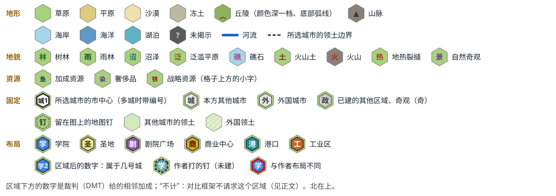

- 每张图画所选城市 3 环内的格，北在上，与游戏画面的方向相同。场景文件里 y 越大越靠北；仓库里其他的图（`refscene.py check --svg`、介绍页）把第 0 行画在最上面，看起来上下颠倒。下面表里的“格”是场景文件里的坐标。
- 左边是作者的布局，中间（或右边）是只算相邻、全 1 的真最优；计入地块（全 1、λ = 1）的真最优和它不同时再画第三张。红框是和作者布局不同的区域。
- 区域下方的数是裁判给这个区域的相邻加成。标题里的“相邻”是裁判给整个布局的加成，还包括它让留在原地的区域多得的部分（日本的区域互相加成），所以可能比下方的数加起来多。

## 8. 逐个场景

### REF04 日本：大阪和冈山（BarbarianHunter）

- 来源：<https://forums.civfanatics.com/threads/civ-of-the-week-japan.635221/page-2>，2019-04-17，存档 `bh-hojo-276`；与 REF05、REF06 同一个存档。
- 规则：存档是风云变幻，按风云变幻评。第 276 回合，科技到信息时代。
- 文明：日本（北条时宗）。明治维新：区域每挨一个区域多得一份标准相邻加成，日本的区域爱扎堆。
- 城市：城 1 大阪（人口 14）、城 2 冈山（7），相隔 4 格。
- 参照布局：大阪的商业中心、剧院广场，冈山的剧院广场、商业中心，都已建，四个挤在两城之间。
- 地图：河、湖、海岸；固定的有大阪的市政广场、冈山的艾尔米塔什博物馆、京都的工业区和圣地，一个普通地图钉。
- 分组：复核组。

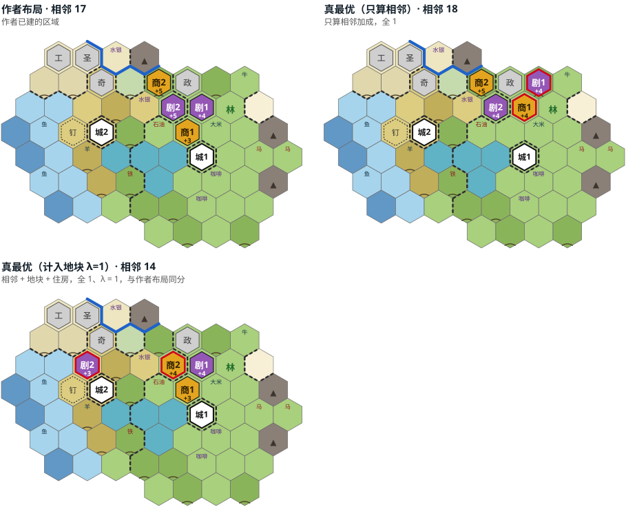

看点：

- 只算相邻时真最优把大阪的商业中心挪到作者剧院广场那格、剧院广场再往外一格，多 1（18 比 17）。
- λ ≥ 0.5 时作者的布局就是真最优；λ = 1 的真最优换了放法，相邻少 3、地块多，同分。
- 冈山的商业中心游戏显示 6、裁判给 5，原因没查。

<details><summary>网格和逐区域的数</summary>

计入地块的差距（%，* = 参照布局就是真最优）：

| 权重 | λ=0 | 0.25 | 0.5 | 0.75 | 1 |
|---|---|---|---|---|---|
| 全 1 | 5.9 | 1.5 | 0.0* | 0.0* | 0.0* |
| 金币减半 | 3.8 | 0.0* | 0.0* | 0.0* | 3.8 |
| 金币、信仰减半 | 3.8 | 0.0* | 0.0* | 0.0* | 3.8 |

| 区域 | 城 | 格 | 来源 | 游戏显示 | 裁判 |
|---|---|---|---|---|---|
| 商业中心 | 大阪 | 9,8 | 已建 | 3 | 3 |
| 剧院广场 | 大阪 | 9,9 | 已建 | 4 | 4 |
| 剧院广场 | 冈山 | 8,9 | 已建 | 5 | 5 |
| 商业中心 | 冈山 | 8,10 | 已建 | 6 | 5 |

</details>

### REF05 日本：东京和静冈（BarbarianHunter）

- 来源：同 REF04（`bh-hojo-276`，第 276 回合，风云变幻，信息时代）。
- 城市：城 1 东京（人口 13）、城 2 静冈（14），相隔 4 格。
- 参照布局：每城学院、圣地、剧院广场、商业中心各一，都已建，各自贴着市中心围成一团。
- 地图：河、湖、泛滥平原；固定的有京都的堤坝和航空港，两个普通地图钉。
- 分组：复核组。

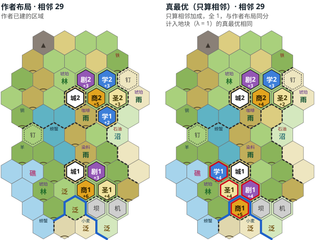

看点：

- 只算相邻时作者的布局和真最优同分（29），真最优换了东京 4 个区域的围法；计入地块（λ = 1）的真最优也是这个放法。
- 差距随 λ 变大（0 → 6.9%）：λ = 1 时作者的布局比真最优多损失 2 点地块。
- 金币、信仰减半时只有 88.9%，那组权重下的真最优也换了放法。

<details><summary>网格和逐区域的数</summary>

| 权重 | λ=0 | 0.25 | 0.5 | 0.75 | 1 |
|---|---|---|---|---|---|
| 全 1 | 0.0* | 1.7 | 3.4 | 5.2 | 6.9 |
| 金币减半 | 8.5 | 10.6 | 12.8 | 14.9 | 17.0 |
| 金币、信仰减半 | 12.5 | 12.5 | 15.0 | 18.8 | 22.5 |

| 区域 | 城 | 格 | 来源 | 游戏显示 | 裁判 |
|---|---|---|---|---|---|
| 商业中心 | 东京 | 7,6 | 已建 | 6 | 6 |
| 圣地 | 东京 | 8,6 | 已建 | 4 | 4 |
| 剧院广场 | 东京 | 7,7 | 已建 | 3 | 3 |
| 学院 | 东京 | 8,10 | 已建 | 2 | 2 |
| 商业中心 | 静冈 | 7,11 | 已建 | 5 | 5 |
| 圣地 | 静冈 | 8,11 | 已建 | 3 | 3 |
| 剧院广场 | 静冈 | 7,12 | 已建 | 3 | 3 |
| 学院 | 静冈 | 8,12 | 已建 | 3 | 3 |

</details>

### REF06 日本：京都（BarbarianHunter）

- 来源：同 REF04（`bh-hojo-276`，第 276 回合，风云变幻，信息时代）。
- 城市：京都（首都，人口 19），单城。
- 参照布局：工业区、圣地、剧院广场（+8），都已建。
- 地图：河绕城、泛滥平原；固定的有军营、娱乐中心、堤坝、航空港和两个奇观，一个普通地图钉。
- 分组：复核组。

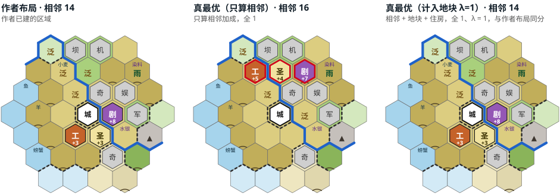

看点：

- 只算相邻时真最优把三个区域都放到城北堤坝、航空港下面那一排（16 比 14），压掉两块修了农场的泛滥平原（一块有小麦）和一座有矿山的丘陵。
- λ = 1 时作者的布局就是真最优：作者把泛滥平原留给了农场。这是“随 λ 变小”的典型场景。

<details><summary>网格和逐区域的数</summary>

| 权重 | λ=0 | 0.25 | 0.5 | 0.75 | 1 |
|---|---|---|---|---|---|
| 全 1 | 14.3 | 10.7 | 7.1 | 3.6 | 0.0* |
| 金币减半 | 14.3 | 10.7 | 7.1 | 3.6 | 0.0* |
| 金币、信仰减半 | 12.0 | 10.0 | 8.0 | 6.0 | 4.0 |

| 区域 | 城 | 格 | 来源 | 游戏显示 | 裁判 |
|---|---|---|---|---|---|
| 工业区 | 京都 | 5,5 | 已建 | 3 | 3 |
| 圣地 | 京都 | 6,5 | 已建 | 3 | 3 |
| 剧院广场 | 京都 | 7,6 | 已建 | 8 | 8 |

</details>

### REF07 澳大利亚：堪培拉和墨尔本（Archon_Wing）

- 来源：<https://forums.civfanatics.com/threads/civ-of-the-week-australia.640147/>，2019-01-05，存档 `aw-curtin-232`；与 REF08 同一个存档。
- 规则：存档是迭起兴衰，按风云变幻评（万神殿“收获女神”在比较用的规则库里没有，去掉了）。第 232 回合，科技到信息时代。
- 文明：澳大利亚（约翰·科廷）。南方大陆：学院、商业中心、圣地、剧院广场在迷人的格上 +1，惊艳的格上 +3。
- 城市：城 1 堪培拉（首都，人口 17）、城 2 墨尔本（12）。
- 参照布局：堪培拉的学院、剧院广场、商业中心、港口，墨尔本的学院、剧院广场、商业中心，都已建。堪培拉学院下面的煤是建成后才揭示的，场景里去掉了。
- 地图：海岸、湖、成片的山；3 格内有 5 个奇观，本方别的城的学院、商业中心、港口在边上。
- 分组：开发组。

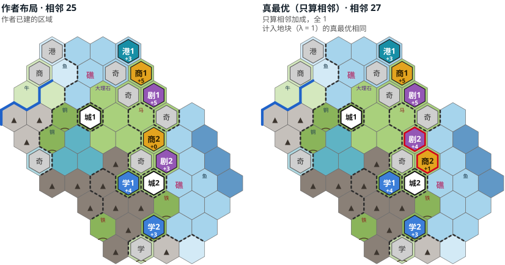

看点：

- 真最优只把墨尔本的剧院广场和商业中心对调（27 比 25），不随 λ 变。
- 游戏显示的数大多比裁判高 1–3，墨尔本的商业中心游戏显示 3、裁判给 0，原因是魅力（第 6 节）。作者和真最优都按场景的魅力算，比较是公平的，但作者当时看到的数和这里不同。

<details><summary>网格和逐区域的数</summary>

| 权重 | λ=0 | 0.25 | 0.5 | 0.75 | 1 |
|---|---|---|---|---|---|
| 全 1 | 8.0 | 8.0 | 8.0 | 8.0 | 8.0 |
| 金币减半 | 9.5 | 7.1 | 7.1 | 7.1 | 7.1 |
| 金币、信仰减半 | 9.5 | 7.1 | 7.1 | 7.1 | 7.1 |

| 区域 | 城 | 格 | 来源 | 游戏显示 | 裁判 |
|---|---|---|---|---|---|
| 学院 | 堪培拉 | 8,8 | 已建 | 7（含政策卡 14） | 4 |
| 剧院广场 | 堪培拉 | 9,12 | 已建 | 8（含政策卡 16） | 5 |
| 商业中心 | 堪培拉 | 8,13 | 已建 | 8（含政策卡 16） | 5 |
| 港口 | 堪培拉 | 8,14 | 已建 | 3（含政策卡 6） | 3 |
| 学院 | 墨尔本 | 9,6 | 已建 | 4（含政策卡 8） | 3 |
| 剧院广场 | 墨尔本 | 9,9 | 已建 | 6（含政策卡 12） | 3 |
| 商业中心 | 墨尔本 | 9,10 | 已建 | 3 | 0 |

</details>

### REF08 澳大利亚：悉尼（Archon_Wing）

- 来源：同 REF07（`aw-curtin-232`，第 232 回合，迭起兴衰按风云变幻评，信息时代）。
- 城市：悉尼（人口 16），单城。
- 参照布局：学院、商业中心、剧院广场、港口，都已建。
- 地图：河、海岸，南边整片是山；3 格内有 3 个奇观和一个军营。
- 分组：开发组。

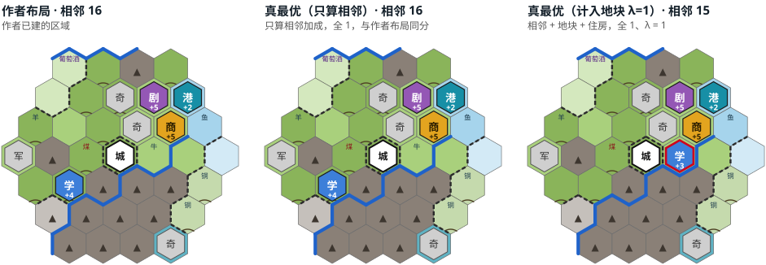

看点：

- 只算相邻时作者的布局就是真最优（16），金币、信仰减半时也是。
- λ = 1 时真最优把学院从西边的丘陵挪到市中心旁有牛的牧场上，相邻少 1，差距 6.2%。
- 游戏显示的数比裁判高 0–3，原因同 REF07。

<details><summary>网格和逐区域的数</summary>

| 权重 | λ=0 | 0.25 | 0.5 | 0.75 | 1 |
|---|---|---|---|---|---|
| 全 1 | 0.0* | 0.0* | 0.0* | 3.1 | 6.2 |
| 金币减半 | 0.0* | 0.0* | 0.0* | 4.0 | 8.0 |
| 金币、信仰减半 | 0.0* | 0.0* | 0.0* | 4.0 | 8.0 |

| 区域 | 城 | 格 | 来源 | 游戏显示 | 裁判 |
|---|---|---|---|---|---|
| 学院 | 悉尼 | 4,5 | 已建 | 5（含政策卡 10） | 4 |
| 商业中心 | 悉尼 | 7,7 | 已建 | 8 | 5 |
| 剧院广场 | 悉尼 | 7,8 | 已建 | 6（含政策卡 12） | 5 |
| 港口 | 悉尼 | 8,8 | 已建 | 2 | 2 |

</details>

### REF09 荷兰：阿姆斯特丹和哈勒姆（Archon_Wing）

- 来源：<https://forums.civfanatics.com/threads/civ-of-the-week-netherlands.637219/>，2018-10，存档 `aw-wilhelmina-237`；与 REF10 同一个存档。
- 规则：存档是迭起兴衰，按风云变幻评（工业区的相邻规则不同）。第 237 回合，科技到信息时代。
- 文明：荷兰（威廉明娜）。大河地带：学院、剧院广场、工业区挨河 +2。
- 城市：城 1 阿姆斯特丹（首都，人口 18）、城 2 哈勒姆（10）。
- 参照布局：阿姆斯特丹的剧院广场、工业区、学院、商业中心，哈勒姆的学院、商业中心、剧院广场，都已建。
- 地图：河网密；3 格内有 5 个奇观（含鲁尔山谷），旁边有城邦布鲁塞尔的工业区。
- 分组：开发组。

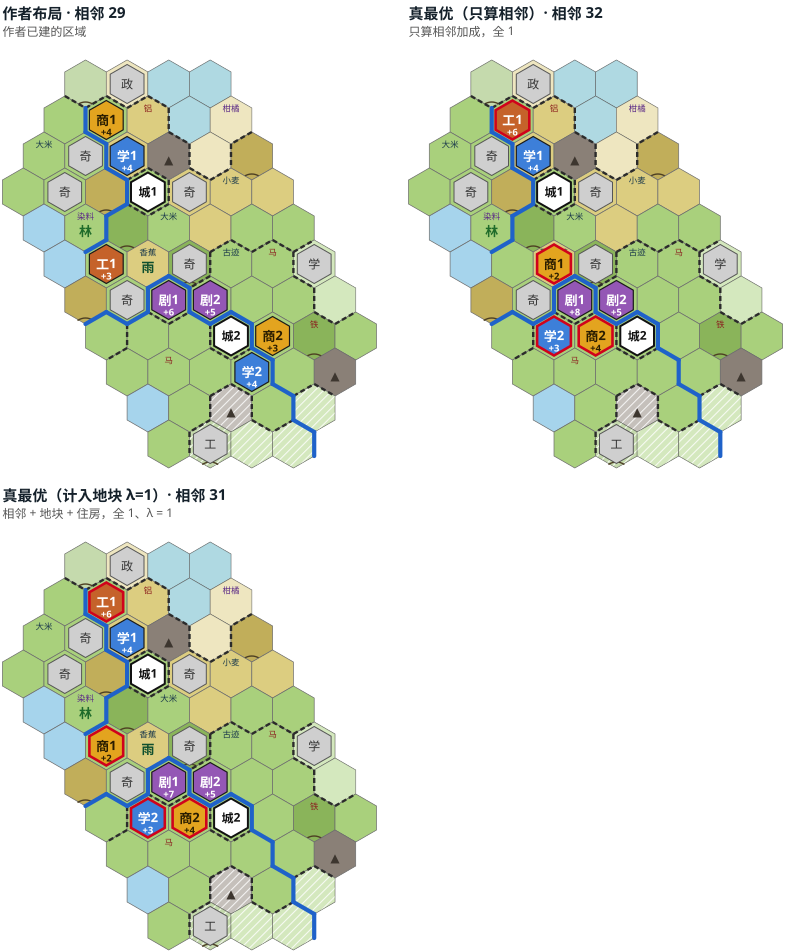

看点：

- 真最优多 3（32 比 29）：阿姆斯特丹的工业区放到作者商业中心那格（+6），阿姆斯特丹的商业中心和哈勒姆的学院、商业中心挪到两城之间，挨着两个剧院广场。
- 差距随 λ 变小（10.3 → 6.9%）。金币、信仰减半时只有 86.4%。
- 工业区游戏显示 4、裁判 3：迭起兴衰和风云变幻的规则差。

<details><summary>网格和逐区域的数</summary>

| 权重 | λ=0 | 0.25 | 0.5 | 0.75 | 1 |
|---|---|---|---|---|---|
| 全 1 | 10.3 | 9.5 | 8.6 | 7.8 | 6.9 |
| 金币减半 | 15.7 | 13.7 | 11.8 | 11.8 | 11.8 |
| 金币、信仰减半 | 15.7 | 13.7 | 11.8 | 11.8 | 11.8 |

| 区域 | 城 | 格 | 来源 | 游戏显示 | 裁判 |
|---|---|---|---|---|---|
| 剧院广场 | 阿姆斯特丹 | 7,8 | 已建 | 6 | 6 |
| 工业区 | 阿姆斯特丹 | 5,9 | 已建 | 4 | 3 |
| 学院 | 阿姆斯特丹 | 6,12 | 已建 | 4 | 4 |
| 商业中心 | 阿姆斯特丹 | 5,13 | 已建 | 4 | 4 |
| 学院 | 哈勒姆 | 9,6 | 已建 | 4 | 4 |
| 商业中心 | 哈勒姆 | 9,7 | 已建 | 3 | 3 |
| 剧院广场 | 哈勒姆 | 8,8 | 已建 | 5 | 5 |

</details>

### REF10 荷兰：乌得勒支（Archon_Wing）

- 来源：同 REF09（`aw-wilhelmina-237`，第 237 回合，迭起兴衰按风云变幻评，信息时代）。
- 城市：乌得勒支（人口 23），单城，城边一片大湖。
- 参照布局：工业区、学院、剧院广场、港口（湖边），都已建。
- 地图：湖 10 格；3 格内有 4 个奇观和市政广场。
- 分组：开发组。

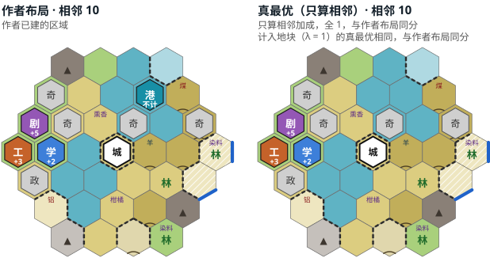

看点：

- 每组权重、每个 λ 下作者的布局都是真最优，真最优的放法也相同。
- 港口在湖边：对比框架在 3 格内只有湖时不请求港口，两边都不算它（游戏里它的相邻加成也是 0）。可用的格很少，这个场景区分不了权重。

<details><summary>网格和逐区域的数</summary>

| 权重 | λ=0 | 0.25 | 0.5 | 0.75 | 1 |
|---|---|---|---|---|---|
| 全 1 | 0.0* | 0.0* | 0.0* | 0.0* | 0.0* |
| 金币减半 | 0.0* | 0.0* | 0.0* | 0.0* | 0.0* |
| 金币、信仰减半 | 0.0* | 0.0* | 0.0* | 0.0* | 0.0* |

| 区域 | 城 | 格 | 来源 | 游戏显示 | 裁判 |
|---|---|---|---|---|---|
| 工业区 | 乌得勒支 | 3,7 | 已建 | 4 | 3 |
| 学院 | 乌得勒支 | 4,7 | 已建 | 2 | 2 |
| 剧院广场 | 乌得勒支 | 4,8 | 已建 | 5 | 5 |
| 港口 | 乌得勒支 | 7,9 | 已建 | 0 | 0 |

</details>

### REF11 日本：京都和东京（Archon_Wing）

- 来源：<https://forums.civfanatics.com/threads/civ-of-the-week-japan.635221/page-2>，2018-08-11，存档 `aw-hojo-236`。
- 规则：存档是迭起兴衰，按风云变幻评（工业区的相邻规则不同）。第 236 回合，科技到原子能时代。
- 文明：日本（北条时宗），明治维新同 REF04。
- 城市：城 1 京都（首都，人口 16）、城 2 东京（9）。
- 参照布局：京都的剧院广场、学院、工业区、港口、商业中心，东京的剧院广场、学院，都已建。
- 地图：河、海岸；京都周围 7 个奇观和水上乐园，东京有市政广场，本方别的城的两个剧院广场、学院、娱乐中心在边上。
- 分组：开发组。

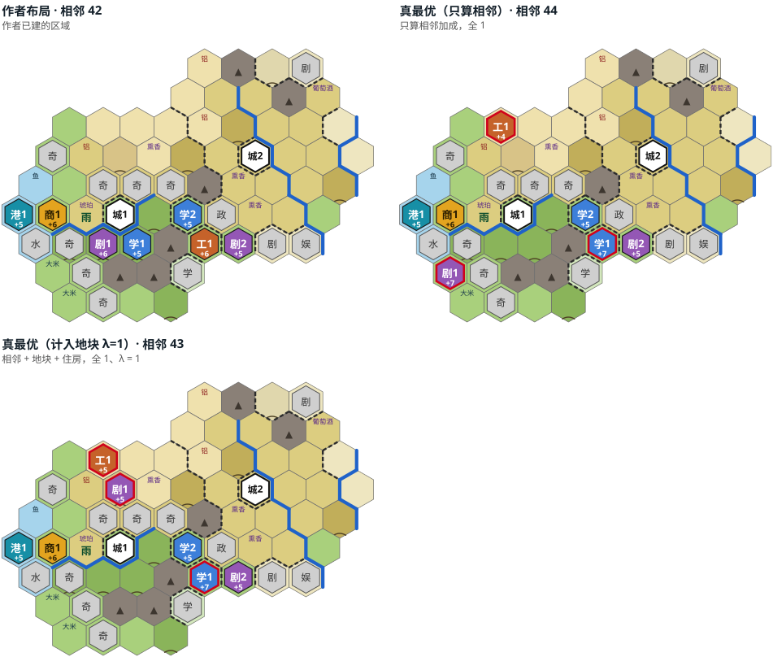

看点：

- 只算相邻时真最优多 2（44 比 42）：学院放到作者工业区那格（+7），工业区挪到城北，剧院广场挪到城西南。
- 差距随 λ 明显变大（4.8 → 26.2%）：作者的区域占了本模组认为值钱的格，λ = 1 的真最优把剧院广场放到沙漠丘陵的矿山上。
- 奇观很多、可用的格少，作者的放法可能受奇观位影响。

<details><summary>网格和逐区域的数</summary>

| 权重 | λ=0 | 0.25 | 0.5 | 0.75 | 1 |
|---|---|---|---|---|---|
| 全 1 | 4.8 | 9.5 | 14.3 | 20.2 | 26.2 |
| 金币减半 | 5.5 | 11.0 | 19.2 | 28.1 | 37.0 |
| 金币、信仰减半 | 5.5 | 11.0 | 19.2 | 28.1 | 37.0 |

| 区域 | 城 | 格 | 来源 | 游戏显示 | 裁判 |
|---|---|---|---|---|---|
| 剧院广场 | 京都 | 5,5 | 已建 | 6（含政策卡 12） | 6 |
| 学院 | 京都 | 6,5 | 已建 | 5（含政策卡 10） | 5 |
| 工业区 | 京都 | 8,5 | 已建 | 6（含政策卡 12） | 6 |
| 港口 | 京都 | 3,6 | 已建 | 5（含政策卡 15） | 5 |
| 商业中心 | 京都 | 4,6 | 已建 | 6（含政策卡 18） | 6 |
| 剧院广场 | 东京 | 9,5 | 已建 | 5（含政策卡 10） | 5 |
| 学院 | 东京 | 8,6 | 已建 | 5（含政策卡 10） | 5 |

</details>

### REF12 中国：西安，一城挑战（DanQuayle）

- 来源：<https://forums.civfanatics.com/threads/the-solo-city-challenge.645236/>，2019-05-01，存档 `dq-qin-145`。一城挑战（神级，大陆地图）；REF13 是同一张图。
- 规则：风云变幻。第 145 回合，科技到文艺复兴时期。
- 文明：中国（秦始皇），没有相邻加成的特性。
- 城市：西安（首都，人口 14），单城。
- 参照布局：圣地、剧院广场、学院，都已建。
- 地图：山多（3 格内 11 座），河；城边 4 个奇观、市政广场和军营。
- 分组：复核组。

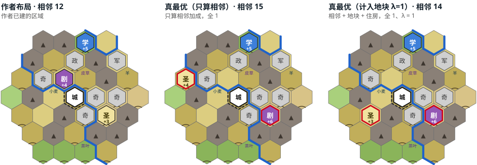

看点：

- 真最优把作者圣地那格让给剧院广场（+6），圣地挪到西边山旁（+4），多 3（15 比 12），比例 80%。
- λ 变大差距变小，但到 λ = 1 仍有 16.7%。
- 一城挑战里奇观位很要紧，作者可能为奇观留了格；和 REF13 对照看。

<details><summary>网格和逐区域的数</summary>

| 权重 | λ=0 | 0.25 | 0.5 | 0.75 | 1 |
|---|---|---|---|---|---|
| 全 1 | 25.0 | 20.8 | 16.7 | 16.7 | 16.7 |
| 金币减半 | 25.0 | 20.8 | 16.7 | 16.7 | 16.7 |
| 金币、信仰减半 | 23.8 | 23.8 | 23.8 | 23.8 | 23.8 |

| 区域 | 城 | 格 | 来源 | 游戏显示 | 裁判 |
|---|---|---|---|---|---|
| 圣地 | 西安 | 7,5 | 已建 | 3（含政策卡 6） | 3 |
| 剧院广场 | 西安 | 5,7 | 已建 | 4 | 4 |
| 学院 | 西安 | 6,9 | 已建 | 5 | 5 |

</details>

### REF13 中国：西安，一城挑战（pahakuutti）

- 来源：同 REF12 的帖子，2019-04-30，存档 `pk-qin-150`；同一张图，另一位作者。
- 规则：风云变幻。第 150 回合，科技到文艺复兴时期。
- 城市：西安（首都，人口 15），单城。
- 参照布局：圣地、商业中心、剧院广场、学院，都已建。
- 地图：同 REF12；城边 7 个奇观（和 REF12 不同）和市政广场。
- 分组：复核组。

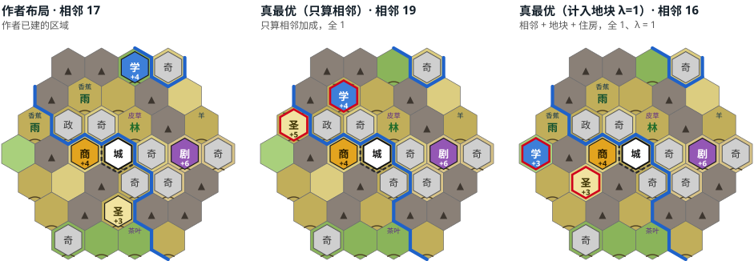

看点：

- 真最优多 2（19 比 17）：圣地挪到西边山旁，和 REF12 的真最优是同一格；学院挪到城北。
- 两位作者都没用那格放圣地。同一张图上两份独立的布局，可以看出这是作者的共同取舍还是真最优没看到的限制。

<details><summary>网格和逐区域的数</summary>

| 权重 | λ=0 | 0.25 | 0.5 | 0.75 | 1 |
|---|---|---|---|---|---|
| 全 1 | 11.8 | 8.8 | 5.9 | 4.4 | 5.9 |
| 金币减半 | 13.3 | 11.7 | 10.0 | 8.3 | 6.7 |
| 金币、信仰减半 | 11.1 | 13.0 | 14.8 | 16.7 | 22.2 |

| 区域 | 城 | 格 | 来源 | 游戏显示 | 裁判 |
|---|---|---|---|---|---|
| 圣地 | 西安 | 6,4 | 已建 | 3 | 3 |
| 商业中心 | 西安 | 5,6 | 已建 | 4 | 4 |
| 剧院广场 | 西安 | 8,6 | 已建 | 6（含政策卡 12） | 6 |
| 学院 | 西安 | 6,9 | 已建 | 4 | 4 |

</details>

### REF14 波兰：克拉科夫和彼得哥什（_Calyx）

- 来源：<https://forums.civfanatics.com/threads/the-jump-up-to-immortal.657854/>，2020-05-13，存档 `ca-jadwiga-100`。作者准备升到不朽难度，发帖求点评。
- 规则：风云变幻。第 100 回合，科技到古典时期。
- 文明：波兰（雅德维加）。立陶宛联邦：圣地从相邻区域拿信仰值加成；这里的布局没有圣地。
- 城市：城 1 克拉科夫（首都，人口 9）、城 2 彼得哥什（6），相隔 4 格，中间是河湾。
- 参照布局：克拉科夫的商业中心、学院，彼得哥什的商业中心（已建），加作者打钉的两个工业区。作者的堤坝钉留在图上。
- 地图：河、泛滥平原、树林、雨林；2 个奇观、市政广场。
- 分组：复核组。

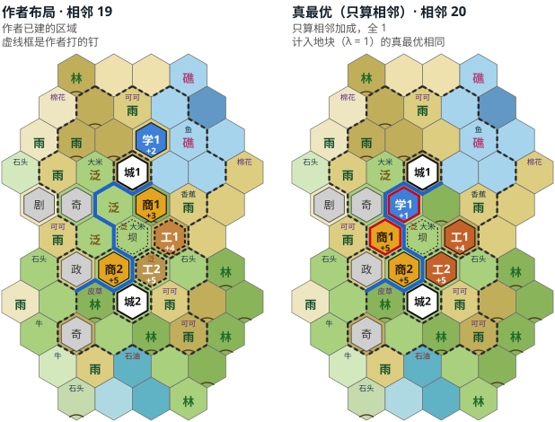

看点：

- 真最优把克拉科夫的商业中心、学院挪进河湾（商业中心 +5，学院只剩 +1），多 1（20 比 19），不随 λ 变。
- 两个商业中心游戏显示 2、裁判给 3 和 5：裁判把作者钉的工业区当已建的邻居。
- 这是第 100 回合的半成品规划，钉是作者的打算，没有建成。

<details><summary>网格和逐区域的数</summary>

| 权重 | λ=0 | 0.25 | 0.5 | 0.75 | 1 |
|---|---|---|---|---|---|
| 全 1 | 5.3 | 5.3 | 5.3 | 5.3 | 5.3 |
| 金币减半 | 6.7 | 6.7 | 6.7 | 6.7 | 6.7 |
| 金币、信仰减半 | 6.7 | 6.7 | 6.7 | 6.7 | 6.7 |

| 区域 | 城 | 格 | 来源 | 游戏显示 | 裁判 |
|---|---|---|---|---|---|
| 商业中心 | 克拉科夫 | 6,9 | 已建 | 2 | 3 |
| 学院 | 克拉科夫 | 6,11 | 已建 | 2 | 2 |
| 商业中心 | 彼得哥什 | 5,7 | 已建 | 2 | 5 |
| 工业区 | 彼得哥什 | 6,7 | 钉 | - | 5 |
| 工业区 | 克拉科夫 | 7,8 | 钉 | - | 4 |

</details>

### REF15 匈牙利：布达、塞格德、米什科尔茨（Sklez）

- 来源：<https://forums.civfanatics.com/threads/sv-discussion-for-gathering-storm.642304/>，2019-02-19，存档 `sk-matthias-58`。第 195 回合科技胜利那一局的第 58 回合（标准设置，盘古大陆）。
- 规则：风云变幻。第 58 回合，科技到古典时期。
- 文明：匈牙利（匈雅提·马加什）。多瑙河之珠：在市中心河对岸建区域和建筑生产力 +50%，不影响相邻加成。
- 城市：城 1 布达（首都，人口 6）、城 2 塞格德（5）、城 3 米什科尔茨（5），南北一串，相隔 4 格。
- 参照布局：已建或在建的 5 个（布达的学院、剧院广场，塞格德的学院、剧院广场，米什科尔茨的学院；只有塞格德的学院已建成），加作者打钉的 3 个（布达的商业中心，米什科尔茨的商业中心、剧院广场）。塞格德学院下面的硝石是建成后才揭示的，场景里去掉了。
- 地图：河网很密、树林多；金字塔、市政广场，作者的其他钉（学院、娱乐中心、两个卡霍基亚土墩，一个写着 Colosseum 的钉）留在图上。
- 分组：开发组。

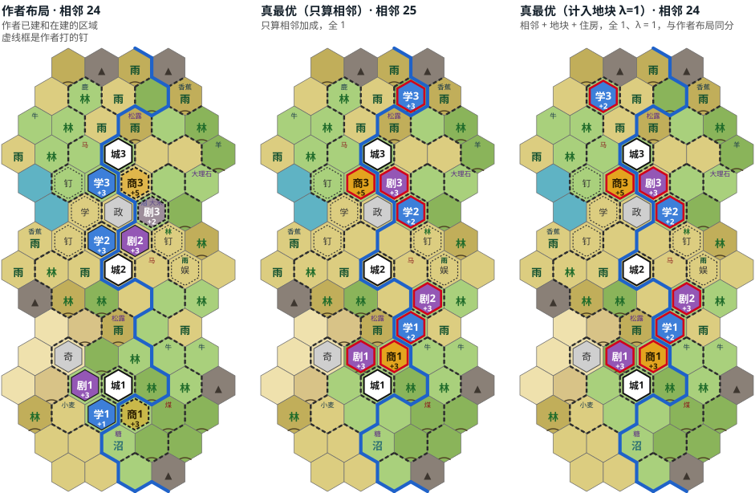

看点：

- 只算相邻时真最优多 1（25 比 24），但 8 个区域全换了格；λ = 1 时作者的布局就是真最优（真最优的放法不同，同分）。
- 多瑙河之珠让作者有理由把区域放到市中心的河对岸，相邻加成里看不到这个收益。
- 早期规划，大部分区域还没建成；真最优最慢（每次约 18 分钟）。

<details><summary>网格和逐区域的数</summary>

| 权重 | λ=0 | 0.25 | 0.5 | 0.75 | 1 |
|---|---|---|---|---|---|
| 全 1 | 4.2 | 3.1 | 2.1 | 1.0 | 0.0* |
| 金币减半 | 5.0 | 3.8 | 2.5 | 1.2 | 0.0* |
| 金币、信仰减半 | 5.0 | 3.8 | 2.5 | 1.2 | 0.0* |

| 区域 | 城 | 格 | 来源 | 游戏显示 | 裁判 |
|---|---|---|---|---|---|
| 学院 | 布达 | 6,6 | 建造中 | 0 | 1 |
| 剧院广场 | 布达 | 5,7 | 建造中 | 2 | 3 |
| 学院 | 塞格德 | 6,12 | 已建 | 2 | 3 |
| 剧院广场 | 塞格德 | 7,12 | 建造中 | 2 | 3 |
| 学院 | 米什科尔茨 | 6,14 | 建造中 | 2 | 3 |
| 商业中心 | 布达 | 7,6 | 钉 | - | 3 |
| 商业中心 | 米什科尔茨 | 7,14 | 钉 | - | 5 |
| 剧院广场 | 米什科尔茨 | 7,13 | 钉 | - | 2 |

</details>

### REF16 毛利：南边三座城（Victoria）

- 来源：<https://forums.civfanatics.com/threads/whats-your-earliest-victory.654421/>，2020-04-25，存档 `vi-kupe-100`。第 140 回合文化胜利那一局的第 100 回合（王子难度，巨型地图，GOTM 规则）；REF17、REF18 是同一个存档。
- 规则：风云变幻。第 100 回合，科技到文艺复兴时期。
- 文明：毛利（库佩）。玛那：未改良的树林、雨林 +1 生产力，不能收获资源；没有相邻加成的特性。
- 城市：城 1 纳鲁阿瓦希亚（人口 9）、城 2 华卡雷瓦雷瓦（5）、城 3 卡皮蒂（5），三城之间有一片小湖，外围是海。
- 参照布局：纳鲁阿瓦希亚的港口、商业中心、学院，华卡雷瓦雷瓦的学院、剧院广场（已建），卡皮蒂的港口、商业中心（在建）。华卡雷瓦雷瓦剧院广场下面的煤是建成后才揭示的，场景里去掉了。
- 地图：海岸、丘陵多、雨林；张掖丹霞（自然奇观），别的城的港口和外国的圣地在边上。
- 分组：开发组。

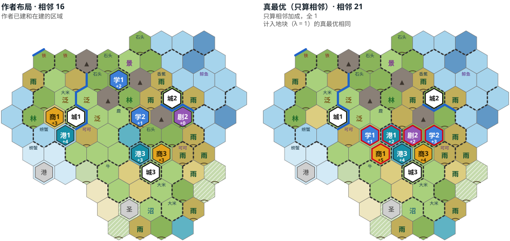

看点：

- 差距最大：76.2%，金币、信仰减半时 67.9%，不随 λ 变。真最优把 5 个区域挤到三城之间的小湖边（港口建在湖上，另有商业中心、两个学院、剧院广场），压掉两个摩艾石像、一个采石场和一个修道院，多 5（21 比 16）。
- 作者的区域分散，华卡雷瓦雷瓦的剧院广场 0、学院 1。三座城都还小，作者在打文化胜利，可能不在乎这几座城的相邻加成。
- 卡皮蒂的港口、商业中心在建，游戏显示 2 和 0，裁判给 3 和 3。

<details><summary>网格和逐区域的数</summary>

| 权重 | λ=0 | 0.25 | 0.5 | 0.75 | 1 |
|---|---|---|---|---|---|
| 全 1 | 31.2 | 31.2 | 31.2 | 31.2 | 31.2 |
| 金币减半 | 47.4 | 47.4 | 47.4 | 47.4 | 47.4 |
| 金币、信仰减半 | 47.4 | 47.4 | 47.4 | 47.4 | 47.4 |

| 区域 | 城 | 格 | 来源 | 游戏显示 | 裁判 |
|---|---|---|---|---|---|
| 港口 | 纳鲁阿瓦希亚 | 5,9 | 已建 | 4（含政策卡 8） | 4 |
| 商业中心 | 纳鲁阿瓦希亚 | 5,10 | 已建 | 3 | 3 |
| 学院 | 纳鲁阿瓦希亚 | 8,12 | 已建 | 2 | 2 |
| 学院 | 华卡雷瓦雷瓦 | 9,10 | 已建 | 1 | 1 |
| 剧院广场 | 华卡雷瓦雷瓦 | 11,10 | 已建 | 0 | 0 |
| 港口 | 卡皮蒂 | 9,8 | 建造中 | 2 | 3 |
| 商业中心 | 卡皮蒂 | 10,8 | 建造中 | 0 | 3 |

</details>

### REF17 毛利：凯厄波伊（Victoria）

- 来源：同 REF16（`vi-kupe-100`，第 100 回合，风云变幻，文艺复兴时期）。
- 城市：凯厄波伊（人口 8），单城，海边。
- 参照布局：港口、剧院广场、圣地，都已建。
- 地图：一半是海，陆地多树林、雨林；大灯塔、神谕两个奇观。
- 分组：开发组。

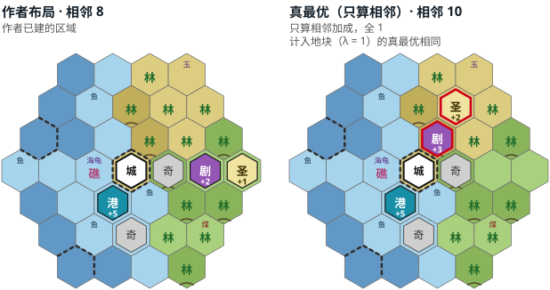

看点：

- 真最优把剧院广场、圣地挪到市中心北边的两块树林上（10 比 8），不随 λ 变，差距 25%。毛利未改良的树林 +1 生产力，作者可能是不想压树林；计入地块时两边的地块损失都是 0（城市人口小，这几格不在要耕作的格里）。
- 相邻加成总共只有 8–10，差 2 就是 20% 以上。

<details><summary>网格和逐区域的数</summary>

| 权重 | λ=0 | 0.25 | 0.5 | 0.75 | 1 |
|---|---|---|---|---|---|
| 全 1 | 25.0 | 25.0 | 25.0 | 25.0 | 25.0 |
| 金币减半 | 36.4 | 36.4 | 36.4 | 36.4 | 36.4 |
| 金币、信仰减半 | 30.0 | 30.0 | 30.0 | 30.0 | 30.0 |

| 区域 | 城 | 格 | 来源 | 游戏显示 | 裁判 |
|---|---|---|---|---|---|
| 港口 | 凯厄波伊 | 5,5 | 已建 | 5（含政策卡 10） | 5 |
| 剧院广场 | 凯厄波伊 | 8,6 | 已建 | 2（含政策卡 4） | 2 |
| 圣地 | 凯厄波伊 | 9,6 | 已建 | 1 | 1 |

</details>

### REF18 毛利：首都（Victoria）

- 来源：同 REF16（`vi-kupe-100`，第 100 回合，风云变幻，文艺复兴时期）。
- 城市：特赫基昂加-努伊-阿-库珀（首都，人口 10），单城。
- 参照布局：港口、剧院广场，都已建。剧院广场下面的马是建成后才揭示的，场景里去掉了。
- 地图：海岸、河、泛滥平原，陆地几乎全是树林、雨林；市政广场。
- 分组：开发组。

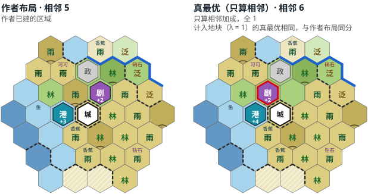

看点：

- 只算相邻时真最优把剧院广场挪一格，港口 +4（6 比 5）；λ = 1 时作者的布局同分，差距随 λ 从 20% 降到 0。
- 只有两个区域、总共 5–6 点，信息少。

<details><summary>网格和逐区域的数</summary>

| 权重 | λ=0 | 0.25 | 0.5 | 0.75 | 1 |
|---|---|---|---|---|---|
| 全 1 | 20.0 | 15.0 | 10.0 | 5.0 | 0.0* |
| 金币减半 | 14.3 | 3.6 | 0.0* | 0.0* | 0.0* |
| 金币、信仰减半 | 14.3 | 3.6 | 0.0* | 0.0* | 0.0* |

| 区域 | 城 | 格 | 来源 | 游戏显示 | 裁判 |
|---|---|---|---|---|---|
| 港口 | 特赫基昂加-努伊-阿-库珀 | 5,7 | 已建 | 3（含政策卡 6） | 3 |
| 剧院广场 | 特赫基昂加-努伊-阿-库珀 | 7,8 | 已建 | 2（含政策卡 4） | 2 |

</details>

### REF19 罗马：罗马和梅迪奥兰（Gaonac'h）

- 来源：<https://forums.civfanatics.com/threads/science-in-the-new-patch-and-trajan-the-beast.647077/>，2019-07-02，存档 `ga-trajan-156`。作者自己风云变幻最快的科技胜利（第 156 回合，神级，盘古大陆）；REF20 是同一个存档。
- 规则：风云变幻。第 156 回合，科技到未来时代。
- 文明：罗马（图拉真），没有相邻加成的特性。
- 城市：城 1 罗马（首都，人口 10）、城 2 梅迪奥兰（10）。
- 参照布局：罗马的学院，梅迪奥兰的学院（已建）和工业区（在建）。
- 地图：山极多（3 格内 21 座）、丘陵、河；两城的航空港、军营、浴场、市政广场、社区都固定。
- 分组：开发组。

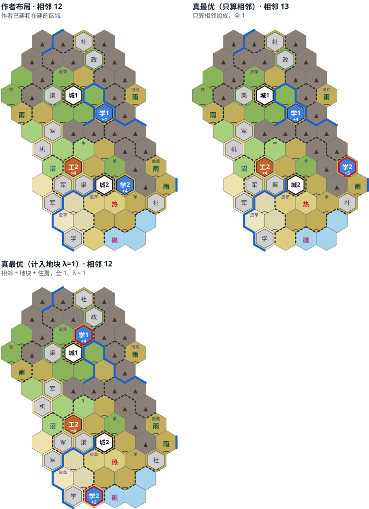

看点：

- 只算相邻时真最优只把梅迪奥兰的学院挪到东边山间（+5），多 1（13 比 12）。
- 差距随 λ 变大最多的一个（8.3 → 50%）：λ = 1 的真最优两个学院都换了格，相邻不变（12），地块少损失 6。作者的学院放在没有改良的平原丘陵上；场景里那两格原来压着区域，地块按能修的改良估，所以这个差距要打折（第 6 节第一条）。

<details><summary>网格和逐区域的数</summary>

| 权重 | λ=0 | 0.25 | 0.5 | 0.75 | 1 |
|---|---|---|---|---|---|
| 全 1 | 8.3 | 14.6 | 25.0 | 37.5 | 50.0 |
| 金币减半 | 8.3 | 14.6 | 25.0 | 37.5 | 50.0 |
| 金币、信仰减半 | 8.3 | 14.6 | 25.0 | 37.5 | 50.0 |

| 区域 | 城 | 格 | 来源 | 游戏显示 | 裁判 |
|---|---|---|---|---|---|
| 学院 | 罗马 | 7,11 | 已建 | 4（含政策卡 8） | 4 |
| 学院 | 梅迪奥兰 | 8,7 | 已建 | 4（含政策卡 8） | 4 |
| 工业区 | 梅迪奥兰 | 6,8 | 建造中 | 4 | 4 |

</details>

### REF20 罗马：普提奥利（Gaonac'h）

- 来源：同 REF19（`ga-trajan-156`，第 156 回合，风云变幻，未来时代）。
- 城市：普提奥利（人口 9），单城，海边。
- 参照布局：学院、港口，都已建。
- 地图：海岸、河、山；娱乐中心、社区固定。
- 分组：开发组。

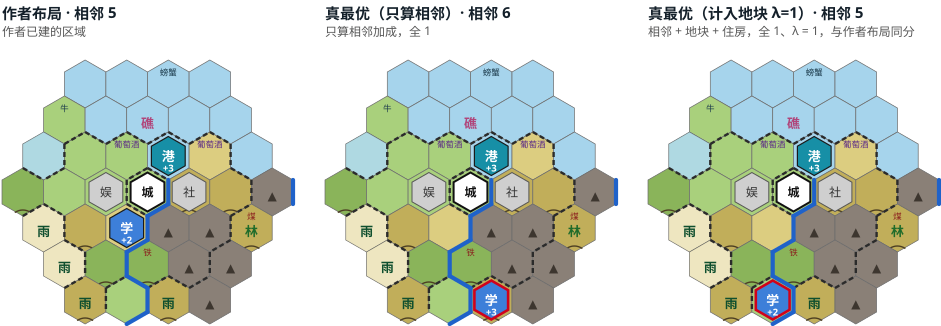

看点：

- 只算相邻时真最优把学院挪到南边山旁（+3），多 1（6 比 5）；λ ≥ 0.5 时作者的布局同分。
- 港口游戏显示 2、裁判给 3，原因没查。

<details><summary>网格和逐区域的数</summary>

| 权重 | λ=0 | 0.25 | 0.5 | 0.75 | 1 |
|---|---|---|---|---|---|
| 全 1 | 20.0 | 5.0 | 0.0* | 0.0* | 0.0* |
| 金币减半 | 28.6 | 7.1 | 0.0* | 0.0* | 0.0* |
| 金币、信仰减半 | 28.6 | 7.1 | 0.0* | 0.0* | 0.0* |

| 区域 | 城 | 格 | 来源 | 游戏显示 | 裁判 |
|---|---|---|---|---|---|
| 学院 | 普提奥利 | 5,5 | 已建 | 2（含政策卡 4） | 2 |
| 港口 | 普提奥利 | 6,7 | 已建 | 2 | 3 |

</details>

## 9. 重画与数据

```bash
python3 -I tests/compare/refmaps.py            # 重画 docs/images/refscenes/ 下的 17 张图和图例
python3 -I tests/compare/refmaps.py --tables   # 另输出第 5 节的总表和第 8 节每个场景的两张表
```

只读 `tests/compare/scenes/REF*.json`、`tests/compare/results/refscore.jsonl`（只算相邻，`all1` 和 `gold-faith-half`）和 `tests/compare/results/refgrid53.jsonl`（计入地块的网格），不重算。科技进度（“科技到某时代”）是本地玩家已研究的最晚的科技所在的时代，不是游戏里的时代。

场景数据里缺的：

- 存档本身不在仓库里，只记了名字（`scenario.save`）；作者、日期和帖子地址都有。
- 6 个城市名在导出时坏了字（城名里的部分汉字变成乱码），图和表里改用游戏文本里的名字（`refmaps.py` 的 `CITY_NAME`）。
- 游戏里的时代没有导出，只有回合数和科技。
- REF04 冈山的商业中心（6 比 5）和 REF20 的港口（2 比 3）游戏显示与裁判不同，原因没查。
