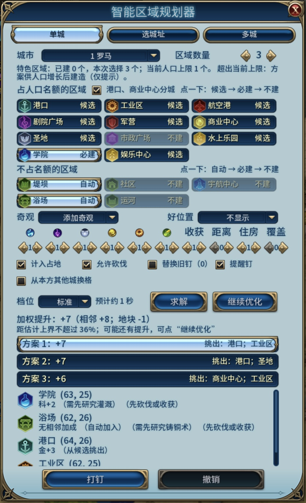
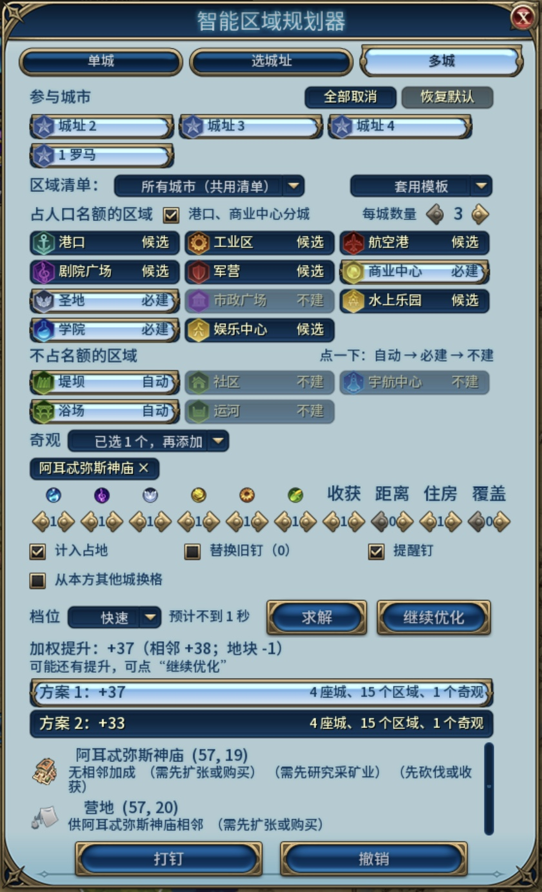
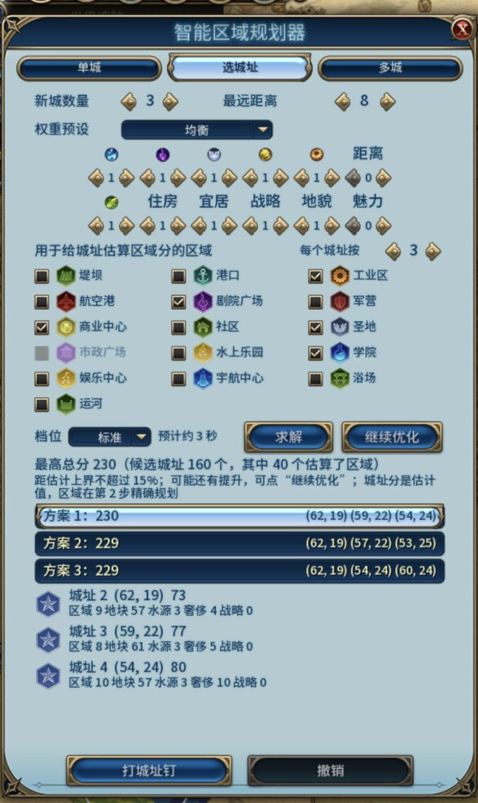

# 自测报告

每次发版前更新：这里只留最近两轮的结果，更早的在 git 历史和 [CHANGELOG](../CHANGELOG.md) 里。发版步骤见 `.claude/skills/sdp-release/SKILL.md`。

环境：macOS 版《文明6》（Aspyr，原生 arm64），维护者的 Steam 账号（缺 16 个 DLC，见 [dev-macos.md](dev-macos.md)），测试模组组只启用官方内容、DMT 和本模组。
测试对局：图拉真（罗马），地图与游戏种子 20261019，经 `tools/game.py newgame --capital --reveal` 快速开局并揭示首都周围 12 格。

"自动验证"指 `tools/run_tests.py` 在游戏内执行断言通过；"截图核对"指截取游戏画面后人工比对；"需你确认"指本机工具做不到、尚未验证的部分。

## 验收清单（需求文档第五节）

| # | 验收项 | 结论 | 证据 |
|---|--------|------|------|
| 1 | 模组列表正确显示中文名与描述 | 自动验证（Lua）+ 截图 | 主菜单状态下，列表用的 `Locale.Lookup(Name)` 与详情用的 `Modding.GetModText` 均返回"智能区域规划器"及中文描述。modinfo 内嵌 `<LocalizedText>`，未启用时也能显示。额外内容界面未能截到本模组那一行（列表需滚动，无法合成点击）。额外内容界面的截图见下 |
| 2 | 启动栏出现图标按钮，点击弹出面板 | 自动验证 + 截图 + 真实鼠标点击（macOS） | `test_panel`：按钮注入、弹窗队列开关、Esc 处理、LuaEvents 开关。截图见下。用系统鼠标事件真实点击面板（`tools/realclick.py`，项数见下）；启动栏按钮本身与 Esc 键仍由测试调用 |
| 3 | 学院+圣地秒级出结果；互惠更优解必须给出 | 自动验证 | `test_solver`：两区域走穷举，结果与 DMT 暴力枚举的最优提升完全相等（全 1 权重与只看科学权重各一次）。耗时见"性能"一节 |
| 4 | 结果行显示坐标与明细；悬停逐项来源与 DMT 图钉一致 | 自动验证 + 截图 | `test_ui`：结果行含坐标，tooltip 等于方案中 DMT 的 tooltip。`test_pins`：打钉后 DMT 为每个钉保存的 tooltip 与方案逐字相同。悬停截图见下 |
| 5 | 打钉生成带区域图标的钉；撤销后新钉被真删除 | 自动验证 + 截图 | `test_pins`：钉图标为 `ICON_<区域>`；撤销后钉从 `GetMapPins()` 消失，DMT 记录清空，玩家自己的钉保留。地图截图见下；撤销后截图中钉全部消失 |
| 6 | 已建区域置灰且不可勾选 | 自动验证 + 截图 | `test_built`：用游戏核心 API 建好学院后，面板里学院格状态为"已建"、变暗且不能点；求解时学院列为未放置（BUILT），已建学院作为固定邻居计分 |
| 7 | 同一状态求解两次结果一致 | 自动验证 | `test_solver`、`test_overlay`、`test_city`、`test_rules` 各有"重复两次深比较相等"的用例。求解器只遍历排序数组，预算按计数，不用随机数和时间 |
| 8 | 勾 3–4 个区域不卡死（≤ ~2 秒） | 自动验证 | `test_solver_perf3/4/8` 设有 2.5 秒墙钟上限，实测远低于上限。快速、标准档同步求解，8 个区域 ≤ 0.3 秒；精细档、多城、城址分帧计算，计算期间游戏照常响应（见"性能与单价"） |

## 自动化测试结果

**v1.4.1 发版前**（第十五轮，2026-10-25，macOS，维护者的账号（缺 16 个 DLC）；改动见 CHANGELOG 的 v1.4.1，#67、#73）：

| 内容 | 结果 |
|------|------|
| 离线测试 | 全部 149 项通过（加了 #67 的一项：没有要规划的内容时“求解”变灰、格子没有悬停提示、镜头只在新结果和换方案时移动、点结果行移到那一格、汇总提示没有搜索次数、多城预览钉带城市编号；#73 的一条：奇观缺区域时原因写出区域）。CI 在 Ubuntu、Windows 上同样通过 |
| 游戏内（罗马） | 风云变幻 108 通过、3 跳过；迭起兴衰 107 通过、4 跳过；原版 101 通过、10 跳过；英文界面（风云变幻）108 通过、3 跳过。启动栏提示里有当前快捷键 |
| 真实鼠标点击 | 改界面时 41 项全部通过（加了求解后镜头移到城市、点结果行镜头移到那一格）。发版前又跑三轮：30、36、39 项通过，失败的都是丢了一次点击、之后的点击照常生效，每轮丢的地方不同；单独把“从本方其他城换格”点 4 次每次都生效。界面代码在 41 项全过那轮之后没有改过 |
| 截图 | 单城、多城两个页签中英文重拍（`docs/images/v10-*.jpg`），都在新开的对局里摆好再拍；英文界面改显示语言，拍完改回，与备份逐字节相同 |
| 后期存档压力测试 | 没跑：这一版只改界面和一句放不下的原因，求解和计分没动（只改界面的版本不跑，维护者 2026-10-25 定）。`SDP_Multi.lua` 只给放不下的奇观那一行加了区域名 |
| 离线对比 | 没跑：求解和合法性规则没改 |

**v1.4.0 发版前**（第十四轮，2026-10-25，macOS，维护者的账号（缺 16 个 DLC）；改动见 CHANGELOG 的 v1.4.0，#51、#58、#61、#63、#64、#65）：

| 内容 | 结果 |
|------|------|
| 离线测试 | 全部 148 项通过（加了单城覆盖、神庙配营地、魅力的古树林与被掠夺改良、邻城的钉不算本城的、城市格子与跟随选中的城、游戏的帧慢时分帧计算不停住） |
| 游戏内（罗马） | 风云变幻 108 通过、3 跳过；迭起兴衰 107 通过、4 跳过；原版 101 通过、10 跳过；英文界面（风云变幻）108 通过、3 跳过。跳过的是要多座城的存档、或规则集没有的内容 |
| 多城的钉（#64） | 京都和名古屋相距 4 格：名古屋用共用清单和用自己清单的方案相同，规划京都时两个已打钉的区域都报“本城已有它的地图钉”；离线分批对比 26 个场景，共用清单不再漏放（原来漏 52 个区域） |
| 分帧计算（#65） | 游戏在前台、后台、隐藏时帧长相同（29–31 毫秒）；模拟游戏每帧慢 60 毫秒时，修正前每帧 4 个单位、52 单位/秒，修正后每帧 194 个单位、3300 单位/秒（`tests/bench/probe_frames.py`） |
| 离线对比（开发集） | `compare.mjs -p sdp` 853 次运行：违规只有“范围内没有合法位置”（水渠、堤坝、书院），与存档的结果相同；和存档结果对得上的 268 行里没有提升变低的 |
| 魅力复核 | 三张存档 9 套方案的魅力、住房全部与游戏相同（上一版 7 套） |
| 后期存档压力测试 | 三张存档用新代码重跑：所有步骤失败 0、增量与全量评估不一致 0、引擎不允许的格 0（下文表格已刷新） |
| 真实鼠标点击 | 39 项通过（加了城市格子、“全部取消”“恢复默认”） |
| 截图 | 单城、多城两个页签中英文重拍（`docs/images/v9-*.jpg`），英文界面改 `AppOptions.txt` 的显示语言，拍完改回，与备份逐字节相同 |

## 性能与单价（游戏内实测，2026-10-20）

### 单价（`tests/bench/cost_dmt.lua`、`cost_search.lua` 与各档实测拟合）

| 操作 | 单价 |
|------|------|
| 一次 DMT 调用（`GetBonusYields` 或 `CanPlacePin`，含清缓存） | 约 0.042 毫秒（5 次运行 0.032–0.054） |
| 一次布局评估（记忆命中为主） | 约 0.01 毫秒 |
| 一个模型搜索节点 | 0.002–0.005 毫秒 |
| `SDP_Tiers` 工作单位（≈ 1 次 DMT 调用 + 周边开销） | 一次算完时约 0.05 毫秒（每秒约 2 万单位）；分帧时单城每秒 7400–9900 单位，多城约 15000 单位 |

分帧时每帧约 30 毫秒，其中计算约 12 毫秒，其余是游戏自己绘制。把目标帧长从 1/30 秒放宽到 1/20 秒，精细档 8 个区域只从 1.8 秒变成 1.76 秒，所以保持 1/30 秒。

### 单城（首都，34 个候选格，计入地块部分；一次算完的墙钟时间）

| 区域数 | 快速 | 标准 | 精细（一次算完 / 实际分帧） | 提升（三档相同） |
|---|---|---|---|---|
| 4 | 0.06 s | 0.15 s | 0.23 s | +8 |
| 6 | 0.09 s | 0.25 s | 0.60 s / 1.5 s | +13 |
| 8 | 0.09 s | 0.29 s | 0.70 s / 1.9 s | +19 |

### 多城（首都 + 1–2 个市中心钉，计入地块部分；最终版本，一次算完的墙钟时间）

| 场景 | 快速 | 标准（含快速档前置） | 精细（含标准档前置） | 联合规划提升（逐城依次规划） |
|---|---|---|---|---|
| 2 城 × 4 区域 | 0.26 s | 0.80 s | 1.41 s | +17（+15） |
| 2 城 × 6 区域 | 0.38 s | 1.14 s | 2.34 s | +25（+25） |
| 3 城 × 4 区域 | 0.23 s | 1.48 s | 3.19 s | +26（+22） |
| 3 城 × 6 区域 | 0.34 s | 2.71 s | 4.25 s | 快速 +38、标准 +39、精细 +40（+35） |

经面板分帧运行（3 城 × 6 区域）：标准档实际等待 4.4 秒，精细档 9.1 秒。预计耗时与实测工作量相差在 10% 以内（例如标准档预计 67835 单位、实际 64150 单位）。

### 选城址（146 个候选，4 个区域估算区域分；一次算完的墙钟时间）

| 新城数 | 快速（精评 20 个） | 标准（40 个） | 精细（80 个） | 最好组合总分（三档相同） |
|---|---|---|---|---|
| 2 | 0.35 s | 0.75 s | 2.83 s | 139 |
| 3 | 0.37 s | 0.86 s | 3.50 s | 206 |

### 预计耗时的校准

原先按"预算用满"估计工作量，单价也按 0.07 毫秒推算，预计耗时比实际长 5–10 倍。现在按实测的典型工作量（`SDP_Tiers` 各档 `Work`）和单价估计：

| 场景 | 原预计 | 现预计（本局第一次求解，默认速度） | 实际 |
|---|---|---|---|
| 单城标准档 6 个区域（同步） | 约 2.9 s | 约 0.2 s（显示"不到 1 秒"） | 0.25 s |
| 单城精细档 6 个区域（分帧） | 约 11 s | 约 0.9 s | 1.5 s |
| 单城精细档 8 个区域（分帧） | 约 13 s | 约 1.5 s | 1.9 s |
| 多城标准档 3 城 × 6 区域（分帧） | 约 5 s | 约 6 s | 4.4 s |
| 多城精细档 3 城 × 6 区域（分帧） | 约 19 s | 约 14 s（求解过一次后约 10 s） | 9.1 s |

每次算完的任务都会更新本机速度，之后的预计更准。

第一轮（MVP）的数据：3 个区域 0.06–0.11 s，4 个区域 0.08–0.19 s，8 个区域 0.18–0.80 s。

## 截图

文档和介绍页在用的截图都在 `docs/images/`，按 `v<轮次>-<内容>.jpg` 命名，用 `tools/shots.py` 拍。当前的：

| 画面 | 文件 |
|------|------|
| 单城页签：学院必建、区域数量 3，权重行有“覆盖”列，三套方案；“收获”列，预计耗时一行写完 |  |
| 多城页签：首都和三个城址钉排成格子，奇观选阿耳忒弥斯神庙，结果里有它要的营地 |  |
| 选城址页签：5 个区域，每个城址按 3 个估分 |  |
| 英文界面：单城、多城、选城址、城址悬停提示 | `v10-en-panel-single.jpg`、`v10-en-panel-multi.jpg`、`v8-en-panel-sites.jpg`、`v7-en-sites-tooltip.jpg` |
| 悬停工业区一行：DMT 的加成来源和覆盖范围内的城市 |  |
| 提醒钉：城址 3 的圣地旁两片树林上的“3 勿砍：圣地 信-1” |  |
| 单城方案的地图预览 |  |
| 后期存档：单城、多城、大陆、群岛 | `v5-late-single.jpg`、`v5-late-multi.jpg`、`v5-late-continents.jpg`、`v5-late-islands.jpg` |
| 额外内容界面：名称、简介为中文，关联 Detailed Map Tacks |  |
| 面板关闭后后台算完，启动栏按钮右上角的标记 |  |

## 需你确认的部分

1. **真实鼠标点击**：macOS 上用系统鼠标事件验证了面板的主要操作（`tools/realclick.py`，项数见上）。还没真实点过的：启动栏按钮、区域数量和权重的箭头、奇观标签和“添加奇观”、继续优化、取消、真实按下 Esc。
2. **Windows**：发版不等 Windows 手测；合作者 2026-10-20、10-21 两轮实测的意见已处理，完整验收清单还没在 Windows 上走过，布局与耗时以 Windows 实测为准。
3. **多人游戏**：未测试。

开发中发现并处理过的问题记在 [AGENTS.md](../AGENTS.md) 的坑表（游戏与 DMT 的行为）和 [multicity-design.md](multicity-design.md) 对应的小节（设计与修正）。
